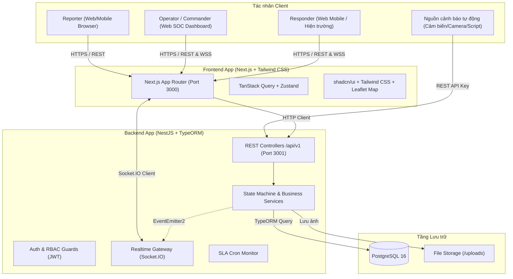
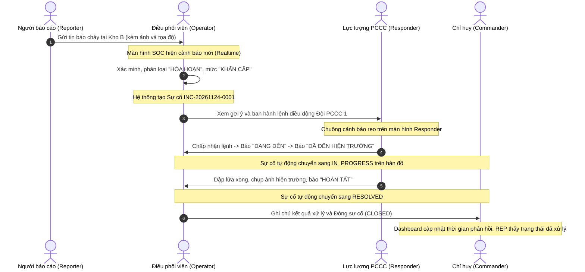

# Đặc tả Yêu cầu Phần mềm (Software Requirements Specification - SRS)

**Dự án:** SafeOps — Hệ thống Quản lý và Điều phối Sự cố An ninh theo Thời gian thực  
**Mã đề tài:** G1.1  
**Phiên bản:** 1.0  
**Ngày lập:** 2026-11-24  
**Trạng thái:** Bản hoàn chỉnh theo thiết kế hệ thống  

---

## 1. Giới thiệu (Introduction)

### 1.1 Mục đích tài liệu (Purpose)
Tài liệu Đặc tả Yêu cầu Phần mềm (SRS) này xác định đầy đủ, chi tiết và có hệ thống toàn bộ các yêu cầu chức năng (Functional Requirements - FR), yêu cầu phi chức năng (Non-Functional Requirements - NFR), quy tắc nghiệp vụ (Business Rules - BR), giao diện bên ngoài và kiến trúc công nghệ cho hệ thống **SafeOps**.  
Tài liệu đóng vai trò làm chuẩn mực nghiệm thu, làm cơ sở hợp đồng giao tiếp giữa các thành viên phát triển frontend, backend, kiểm thử viên (QA/QC) và người hướng dẫn dự án.

### 1.2 Phạm vi sản phẩm (Scope)
**SafeOps** là giải pháp nền tảng web tích hợp thời gian thực phục vụ Trung tâm Điều hành An ninh (Security Operations Center - SOC) cho các khu công nghiệp, khu đô thị hoặc khuôn viên quy mô lớn.  
Hệ thống cung cấp:
- Tiếp nhận cảnh báo đa nguồn (người báo cáo, nhập trực tiếp từ cuộc gọi tổng đài, cảm biến/camera mô phỏng).
- Xác minh, phân loại, đánh giá mức độ khẩn cấp (SLA) và phát hiện trùng lặp sự cố.
- Giám sát vị trí trực quan trên nền bản đồ số.
- Điều phối lực lượng hiện trường (bảo vệ, PCCC, y tế, kỹ thuật) với thuật toán gợi ý tối ưu theo cự ly và trạng thái sẵn sàng.
- Giám sát tiến độ xử lý đa điểm theo thời gian thực (Realtime via WebSockets).
- Ghi nhật ký bất biến phục vụ truy vết, hậu kiểm và dashboard thống kê điều hành.

*Ngoài phạm vi (Out of Scope):* Không xử lý AI/nhận diện khuôn mặt từ camera, không theo dõi định vị GPS liên tục ngoài trời, không tích hợp phần cứng cảm biến vật lý thực tế (chỉ mô phỏng bằng REST Webhook).

### 1.3 Định nghĩa và thuật ngữ (Definitions & Acronyms)

| Thuật ngữ | Diễn giải |
|---|---|
| **Alert** (Cảnh báo) | Dữ liệu cảnh báo thô, chưa xác minh, phát sinh từ người báo cáo hoặc nguồn tự động. |
| **Incident** (Sự cố) | Cảnh báo đã được Operator xác minh, gán mức ưu tiên, loại sự cố và đưa vào quy trình chỉ huy. |
| **Unit** (Lực lượng) | Đơn vị/đội ngũ phản ứng tại chỗ (Tổ bảo vệ, Xe PCCC, Tổ sơ cấp cứu, Kỹ thuật). |
| **Dispatch** (Lệnh điều phối) | Lệnh phân công một Lực lượng cụ thể tham gia giải quyết một Sự cố xác định. |
| **SLA** | Service Level Agreement — Cam kết thời gian xử lý tối đa cho từng mốc trạng thái. |
| **SOC** | Security Operations Center — Trung tâm chỉ huy và điều hành an ninh. |
| **Haversine** | Công thức tính khoảng cách đường chim bay giữa 2 cặp tọa độ địa lý (kinh độ, vĩ độ). |

### 1.4 Tài liệu tham chiếu (References)
- [`docs/00-requirements/overview.md`](../00-requirements/overview.md): Tổng quan bài toán, phân loại và SLA.
- [`docs/00-requirements/roles-permissions.md`](../00-requirements/roles-permissions.md): Ma trận phân quyền theo vai trò.
- [`docs/00-requirements/user-stories.md`](../00-requirements/user-stories.md): Danh mục User Story chi tiết.
- [`docs/02-architecture/folder-structure.md`](../02-architecture/folder-structure.md): Cấu trúc tổ chức mã nguồn và quy chuẩn kỹ thuật.
- [`docs/02-architecture/incident-state-machine.md`](../02-architecture/incident-state-machine.md): Máy trạng thái và quy tắc chuyển đổi.
- [`docs/02-architecture/realtime-events.md`](../02-architecture/realtime-events.md): Cơ chế WebSocket / Socket.IO và danh mục sự kiện.
- [`docs/03-database/erd.md`](../03-database/erd.md): Lược đồ cơ sở dữ liệu vật lý và chỉ mục.
- [`docs/04-api/api-contract.md`](../04-api/api-contract.md): Hợp đồng giao diện lập trình ứng dụng RESTful API.

---

## 2. Mô tả tổng thể (Overall Description)

### 2.1 Bối cảnh hệ thống (Product Perspective)

SafeOps hoạt động theo mô hình Client-Server hiện đại, chia tách rõ rệt giữa Frontend Web Application và Backend API Server, trao đổi dữ liệu qua giao thức kép: **REST API** (xử lý dữ liệu nguồn chân lý) và **Socket.IO** (thông báo cập nhật đẩy thời gian thực).

### 2.2 Công nghệ nền tảng (Technology Stack)

| Tầng (Layer) | Công nghệ lựa chọn | Vai trò & Mục đích |
|---|---|---|
| **Frontend Framework** | **Next.js (App Router, TypeScript)** | Xây dựng giao diện Web SPA/SSR hiện đại, hỗ trợ layout theo vai trò. |
| **Frontend Styling** | **Tailwind CSS + shadcn/ui** | Thiết kế giao diện nhất quán, tối ưu hiệu năng render, tương thích thiết bị di động. |
| **State & Data Fetching** | **TanStack Query (React Query) + Zustand** | Quản lý cache dữ liệu REST, đồng bộ hóa tự động khi có tín hiệu WebSocket; quản lý filter state. |
| **Bản đồ số** | **Leaflet (react-leaflet) + OpenStreetMap** | Hiển thị tọa độ sự cố, vị trí lực lượng, vẽ bán kính tìm kiếm (không cần API key trả phí). |
| **Backend Framework** | **NestJS (TypeScript)** | Kiến trúc module hóa chặt chẽ (Clean Architecture), Dependency Injection, validation tự động. |
| **ORM / Database** | **PostgreSQL 16 + TypeORM** | Lưu trữ quan hệ ACID, sử dụng Migration (tắt synchronize), hỗ trợ UUID, Jsonb và Locking. |
| **Thời gian thực (Realtime)** | **Socket.IO (`@nestjs/websockets`)** | Đẩy sự kiện theo kênh phòng (Room-based), tự động kết nối lại khi mất mạng. |
| **Quản lý gói (Package Mgr)** | **pnpm** | Tối ưu dung lượng ổ đĩa, cài đặt phụ thuộc nhanh và đồng bộ lockfile. |
| **Đóng gói & Vận hành** | **Docker & Docker Compose** | Tự chứa môi trường (Containerized), độc lập cho cả Backend và Frontend. |
| **Mở rộng tương lai** | *Redis (cache/pubsub), MinIO (S3 storage), PostGIS* | Sẵn sàng tích hợp khi mở rộng quy mô đa cụm máy chủ. |

### 2.3 Phân nhóm người dùng & Ma trận vai trò (User Classes & Characteristics)

Hệ thống định nghĩa 5 vai trò (Role) độc quyền (FR-AUTH-03):

1. **REPORTER (Người báo cáo):** Cư dân, cán bộ nhân viên, bảo vệ gác cổng. Gửi tin báo sự cố kèm vị trí, hình ảnh; theo dõi kết quả xử lý của chính mình.
2. **OPERATOR (Điều phối viên SOC):** Trực màn hình chỉ huy. Tiếp nhận, thẩm định cảnh báo, phát hiện trùng lặp, khởi tạo sự cố, điều phối lực lượng và đôn đốc tiến độ.
3. **RESPONDER (Lực lượng phản ứng hiện trường):** Thuộc một tổ đội phản ứng (PCCC, an ninh, y tế...). Tiếp nhận nhiệm vụ, cập nhật trạng thái di chuyển/hiện trường, gửi ảnh và báo cáo kết quả.
4. **COMMANDER (Chỉ huy / Trưởng ca):** Giám sát toàn cục dashboard, can thiệp điều hành đặc biệt (mở lại sự cố, phê duyệt đóng sự cố, xử lý vi phạm SLA).
5. **ADMIN (Quản trị viên hệ thống):** Quản lý tài khoản, danh mục loại sự cố, cấu hình SLA và giám sát hệ thống.

---

## 3. Quy tắc nghiệp vụ cốt lõi (Business Rules - BR)

- **BR-01 (Mã sự cố duy nhất):** Mỗi sự cố được cấp mã định danh duy nhất theo ngày: `INC-YYYYMMDD-NNNN` (ví dụ: `INC-20261124-0001`).
- **BR-02 (Giải trình bắt buộc):** Mọi hành động hủy sự cố, từ chối lệnh, thu hồi lệnh, loại bỏ cảnh báo hoặc mở lại sự cố đều bắt buộc phải nhập lý do văn bản (`reason`).
- **BR-03 (Bảo toàn dữ liệu / Soft Delete):** Tuyệt đối không xóa vật lý (Hard delete) dữ liệu nghiệp vụ quan trọng (Alerts, Incidents, Dispatches). Mọi bảng sử dụng cột `deleted_at`.
- **BR-04 (Tính toàn vẹn chuyển trạng thái):** Sự cố chỉ được chuyển trạng thái theo đúng sơ đồ máy trạng thái. Mọi bước chuyển đều ghi nhận một bản ghi bất biến trong `incident_logs`.
- **BR-05 (Quy tắc suy diễn trạng thái tự động):**
  - Sự cố chuyển sang `IN_PROGRESS` ngay khi có ít nhất một lực lượng báo `ON_SCENE`.
  - Sự cố chỉ được chuyển sang `RESOLVED` khi toàn bộ các lệnh điều phối đang hoạt động đều đã hoàn thành (`DONE`).
  - Khi một lệnh bị từ chối/thu hồi mà chưa có ai hoàn thành, sự cố tự động quay về `CONFIRMED`.
- **BR-06 (Nguyên tắc khả dụng của lực lượng):** Lực lượng ở trạng thái `BUSY` (đang làm nhiệm vụ) hoặc `OFFLINE` (nghỉ ca) sẽ không được gợi ý điều phối.
- **BR-07 (Trạng thái liên kết lực lượng):** Lực lượng tự động chuyển sang `BUSY` khi nhận lệnh điều phối mới; tự động trở về `AVAILABLE` khi tất cả các lệnh được giao đã kết thúc.
- **BR-08 (Xử lý khi bị từ chối):** Khi lực lượng từ chối lệnh (`DECLINED`), hệ thống thông báo tức thì cho Operator và không tự ý phân công lại để tránh sai lệch chiến thuật.
- **BR-09 (Bảo mật thông tin nhạy cảm):** Số điện thoại và liên hệ của người báo cáo chỉ được phép hiển thị cho vai trò `OPERATOR` và `COMMANDER`.
- **BR-10 (Ràng buộc tệp đính kèm):** Tệp tải lên chỉ chấp nhận định dạng ảnh (`image/jpeg`, `image/png`, `image/webp`), dung lượng tối đa 5 MB/tệp, tối đa 5 ảnh trên mỗi lượt báo cáo/cập nhật.
- **BR-11 (Định vị khoảng cách):** Cự ly gợi ý lực lượng được tính toán bằng giải thuật Haversine đường chim bay từ vị trí sự cố đến tọa độ hiện tại của lực lượng.
- **BR-12 (Kiểm soát mức ưu tiên):** Cho phép nâng/hạ mức độ ưu tiên (`priority`) của sự cố trong suốt quá trình xử lý, nhưng bắt buộc lưu vết lý do điều chỉnh vào nhật ký.
- **BR-13 (Phân loại ban đầu):** Cảnh báo do `REPORTER` tạo ra có thể chưa có mức ưu tiên, hệ thống đưa vào hàng đợi xác minh của Operator.
- **BR-14 (Cảnh báo tự động):** Cảnh báo nhận qua Webhook tự động có thể mang sẵn gợi ý loại sự cố và mức ưu tiên, nhưng vẫn yêu cầu Operator xác nhận để tạo sự cố chính thức.

---

## 4. Yêu cầu tính năng hệ thống (Functional Requirements)

### 4.1 Phân hệ Xác thực & Quản trị Tài khoản (AUTH & USERS)
- **FR-AUTH-01:** Đăng nhập an toàn qua tài khoản/mật khẩu, mật khẩu mã hóa bcrypt độ an toàn cao.
- **FR-AUTH-02:** Cơ chế cấp phát cặp JWT Access Token (ngắn hạn, 15 phút) và Refresh Token (7 ngày, lưu hash bảo mật trong DB), hỗ trợ thu hồi token khi đăng xuất.
- **FR-AUTH-03:** Mỗi tài khoản gán cố định 1 trong 5 vai trò hệ thống.
- **FR-AUTH-04:** Cho phép công chúng tự đăng ký tài khoản người báo cáo (`REPORTER`). Các vai trò nghiệp vụ khác do `ADMIN` tạo.
- **FR-AUTH-05:** Toàn bộ REST endpoint và Socket handshake phải thẩm định quyền qua Guard/Middleware ở phía Backend.
- **FR-ADMIN-01:** `ADMIN` có thể tạo mới, khóa/mở khóa tài khoản, phân loại lại vai trò và đặt lại mật khẩu.
- **FR-ADMIN-02:** `ADMIN` quản lý danh mục loại sự cố (thêm, sửa, vô hiệu hóa, cấu hình danh sách lực lượng gợi ý tương ứng).

### 4.2 Phân hệ Tiếp nhận & Xử lý Cảnh báo (ALERT)
- **FR-ALERT-01:** Form gửi báo cáo cho `REPORTER` trên nền web/di động: nhập mô tả, chọn vị trí trực quan trên bản đồ Leaflet hoặc định vị GPS trình duyệt, đính kèm tối đa 5 ảnh.
- **FR-ALERT-02:** Giao diện tiếp nhận nhanh cho `OPERATOR` nhập thông tin cảnh báo khi tiếp nhận điện thoại nóng.
- **FR-ALERT-03:** Cung cấp REST Webhook `POST /api/v1/alerts/automated` bảo vệ bằng `x-api-key` để tích hợp thiết bị IoT mô phỏng.
- **FR-ALERT-04:** Lưu trữ đầy đủ nguồn gốc cảnh báo (`REPORTER`, `OPERATOR`, `AUTOMATED`), thời điểm nhận và dấu vết người báo.
- **FR-ALERT-05:** Hàng đợi cảnh báo thời gian thực sắp xếp theo mức độ nghiêm trọng và thời gian chờ xử lý, gắn nhãn đếm lùi SLA.
- **FR-ALERT-06:** `OPERATOR` xác nhận cảnh báo (`CONFIRMED` tạo Sự cố), loại bỏ (`DISMISSED` kèm lý do) hoặc gộp vào sự cố có sẵn (`MERGED`).
- **FR-ALERT-07:** Tự động phát hiện và gợi ý cảnh báo trùng lặp dựa trên khoảng cách địa lý (bán kính ≤ 100m) và thời gian (trong vòng ≤ 10 phút).
- **FR-ALERT-08:** Cơ chế Rate Limiting (giới hạn tần suất) chống tấn công spam gửi cảnh báo rác.

### 4.3 Phân hệ Quản lý Sự cố (INCIDENT)
- **FR-INC-01:** Quản lý hồ sơ sự cố toàn diện: Mã code, tiêu đề, mô tả, phân loại, mức độ khẩn cấp, tọa độ, các mốc thời gian xử lý và lịch sử thao tác.
- **FR-INC-02:** Khởi tạo sự cố trực tiếp từ cảnh báo được duyệt hoặc tạo trực tiếp bởi `OPERATOR`/`COMMANDER`.
- **FR-INC-03:** Cho phép chỉnh sửa thông tin sự cố khi đang trong các giai đoạn xử lý, tự động ghi nhật ký biến động.
- **FR-INC-04:** Thực thi máy trạng thái khép kín: `NEW` → `CONFIRMED` → `DISPATCHED` → `IN_PROGRESS` → `RESOLVED` → `CLOSED` (kèm nhánh `CANCELLED`).
- **FR-INC-05:** Quản lý thư viện ảnh đính kèm hiện trường và tài liệu liên quan đến sự cố.
- **FR-INC-06:** Danh sách tra cứu sự cố đa tiêu chí: lọc theo trạng thái, mức độ ưu tiên, chủng loại, khoảng thời gian và tìm kiếm văn bản toàn diện theo mã/tiêu đề.
- **FR-INC-07:** Màn hình chi tiết sự cố tổng hợp: thông tin, tọa độ bản đồ, danh sách lực lượng điều phối, timeline diễn tiến và danh mục các hành động được phép (`allowedActions`).
- **FR-INC-08:** `COMMANDER` có đặc quyền mở lại sự cố (`REOPEN` chuyển về `CONFIRMED`) khi phát sinh tình tiết mới sau khi đã giải quyết hoặc đóng để Operator tiếp tục giao lệnh điều phối.
- **FR-INC-09:** `REPORTER` có thể xem danh sách và diễn tiến giải quyết các báo cáo do chính mình khởi tạo.

### 4.4 Phân hệ Quản lý Lực lượng & Điều phối (UNIT & DISPATCH)
- **FR-UNIT-01:** Quản lý danh bạ các đội phản ứng: Tên đơn vị, chủng loại chuyên môn, khu vực ứng trực, thông tin liên lạc và danh sách nhân sự thành viên.
- **FR-UNIT-02:** Theo dõi 3 trạng thái khả dụng của lực lượng: `AVAILABLE`, `BUSY`, `OFFLINE`.
- **FR-UNIT-03:** Cập nhật vị trí ứng trực của lực lượng thủ công hoặc theo vị trí báo cáo gần nhất.
- **FR-UNIT-04:** `RESPONDER` có thể tự chuyển trạng thái làm việc (vào ca/hết ca) giữa `AVAILABLE` và `OFFLINE`.
- **FR-DISP-01:** Thuật toán tự động tìm kiếm và xếp hạng lực lượng đề xuất: Lọc theo chuyên môn phù hợp loại sự cố, đang `AVAILABLE`, sắp xếp tăng dần theo cự ly Haversine.
- **FR-DISP-02:** `OPERATOR` phân công 1 hoặc nhiều lực lượng đến hiện trường kèm chỉ dẫn tác chiến.
- **FR-DISP-03:** Mỗi lệnh điều phối có quy trình phản hồi riêng: `ASSIGNED` → `ACCEPTED` (hoặc `DECLINED`) → `EN_ROUTE` → `ON_SCENE` → `DONE`.
- **FR-DISP-04:** `RESPONDER` có màn hình "Việc của tôi" (`my-tasks`) để tiếp nhận lệnh, xem chỉ dẫn và vị trí cần đến.
- **FR-DISP-05:** `RESPONDER` gửi báo cáo kết quả hiện trường, đính kèm hình ảnh hoàn thành nhiệm vụ.
- **FR-DISP-06:** `OPERATOR`/`COMMANDER` có quyền thu hồi lệnh điều phối (`CANCELLED`) kèm lý do rõ ràng.

### 4.5 Phân hệ Bản đồ Số Giám sát (MAP)
- **FR-MAP-01:** Bản đồ số trực quan thể hiện toàn bộ các sự cố đang mở với marker phân màu/biểu tượng theo loại và mức độ ưu tiên.
- **FR-MAP-02:** Thể hiện vị trí và trạng thái của các lực lượng phản ứng trên cùng giao diện bản đồ.
- **FR-MAP-03:** Tương tác trực tiếp: Bấm vào điểm sự cố để xem tóm tắt thông tin và điều hướng nhanh sang chi tiết điều phối.
- **FR-MAP-04:** Cung cấp bộ lọc bản đồ theo bán kính, mức ưu tiên và loại sự cố.
- **FR-MAP-05:** Bản đồ cập nhật vị trí điểm mới và biến động trạng thái tức thì không cần tải lại trang nhờ Socket.IO.

### 4.6 Phân hệ Thời gian thực & Thông báo (REALTIME & NOTIFICATIONS)
- **FR-RT-01:** Thiết lập kết nối hai chiều bảo mật qua Socket.IO với cơ chế phân phòng logic (`role:{ROLE}`, `user:{USER_ID}`, `unit:{UNIT_ID}`).
- **FR-RT-02:** Tự động phát hiện đứt kết nối, hiển thị huy hiệu trạng thái mạng và tự động đồng bộ lại dữ liệu khi có mạng.
- **FR-NOTI-01:** Lưu vết thông báo vào cơ sở dữ liệu trước khi đẩy qua Socket (đảm bảo không thất thoát thông báo kể cả khi người dùng offline).
- **FR-NOTI-02:** Trung tâm thông báo cá nhân: xem danh sách, đếm số chưa đọc, đánh dấu đã đọc.

### 4.7 Phân hệ Báo cáo Thống kê & Giám sát SLA (DASHBOARD & SLA)
- **FR-DASH-01:** Thẻ chỉ số tổng quan (KPI Cards): Số sự cố đang mở, số cảnh báo chờ xác nhận, số lực lượng sẵn sàng, số ca khẩn cấp.
- **FR-DASH-02:** Biểu đồ cơ cấu sự cố theo loại hình và phân bổ mức độ nghiêm trọng theo thời gian.
- **FR-DASH-03:** Thống kê thời gian đáp ứng trung bình (Nhận tin → Xác nhận → Điều phối → Tiếp cận hiện trường → Hoàn tất).
- **FR-SLA-01:** Tác vụ nền định kỳ (Cron Job 30s) kiểm tra quét các mốc vi phạm cam kết SLA (Xác nhận cảnh báo, Ban hành lệnh điều phối).
- **FR-SLA-02:** Tự động phát tín hiệu cảnh báo vi phạm SLA (`sla.breached`) đến màn hình của Operator và Trưởng ca khi quá hạn.

---

## 5. Yêu cầu phi chức năng (Non-Functional Requirements)

### 5.1 Hiệu năng (Performance - NFR-P)
- **NFR-P01:** Tốc độ phản hồi của các REST API truy vấn dữ liệu thông thường đạt dưới 300ms trong điều kiện mạng tiêu chuẩn.
- **NFR-P02:** Độ trễ truyền phát sự kiện Socket.IO từ khi server phát sinh giao dịch thành công đến màn hình Client không quá 1.0 giây.
- **NFR-P03:** Hỗ trợ xử lý tải đồng thời tối thiểu 50 kết nối Socket.IO hoạt động liên tục trong môi trường kiểm thử và demo.
- **NFR-P04:** Các danh sách dữ liệu lớn (Sự cố, Nhật ký, Thông báo) bắt buộc phân trang (Pagination) tối đa 100 bản ghi/lần gọi.

### 5.2 Bảo mật & An toàn Dữ liệu (Security - NFR-S)
- **NFR-S01:** Mật khẩu người dùng được băm bằng thuật toán Bcrypt với Salt Round thích hợp, không bao giờ lưu văn bản rõ (plaintext).
- **NFR-S02:** Kiểm soát chặt chẽ xác thực và phân quyền RBAC ở tầng Backend thông qua NestJS Guards.
- **NFR-S03:** Lọc và kiểm định nghiêm ngặt dữ liệu đầu vào (Input Sanitization & Validation) qua class-validator / DTO để ngăn chặn SQL Injection, XSS.
- **NFR-S04:** Ràng buộc bảo vệ file tải lên: Kiểm tra MIME type thực tế, giới hạn kích thước tối đa 5MB, đổi tên file bằng chuỗi UUID ngẫu nhiên trước khi lưu trữ.
- **NFR-S05:** Cơ chế giới hạn tốc độ gọi (Rate Limiting) trên các endpoint mở nhằm ngăn ngừa tấn công DoS/DDoS.

### 5.3 Độ tin cậy & Khả năng chịu lỗi (Reliability - NFR-R)
- **NFR-R01:** Sử dụng Database Transaction (ACID) cho toàn bộ các thao tác nghiệp vụ phức tạp liên quan đến máy trạng thái (Sự cố, Lệnh, Lực lượng).
- **NFR-R02:** Tính toàn vẹn khi mất kết nối mạng: Frontend tự động cache truy vấn qua TanStack Query và tự động làm mới khi kết nối lại (Socket reconnect).
- **NFR-R03:** Tránh xung đột cập nhật đồng thời (Concurrency Control) bằng trường `version` kết hợp Optimistic Locking trên các bảng trung tâm.

### 5.4 Khả năng bảo trì & Tiêu chuẩn phát triển (Maintainability - NFR-M)
- **NFR-M01:** Tổ chức mã nguồn chuẩn Clean Architecture / Feature-driven rõ ràng theo tài liệu kiến trúc.
- **NFR-M02:** Không dùng phụ thuộc vòng (Circular Dependency) giữa các module NestJS.
- **NFR-M03:** Quản lý cơ sở dữ liệu 100% bằng Migration có kiểm soát phiên bản (TypeORM Migration), không bật chế độ `synchronize: true` trong môi trường chạy thật.
- **NFR-M04:** Cung cấp tài liệu API tương tác tự động thông qua Swagger OpenAPI tại `/api`.

### 5.5 Tính tương thích & Khả năng mở rộng (Extensibility - NFR-E)
- **NFR-E01:** Hệ thống triển khai nhanh chóng thông qua Docker và Docker Compose trên môi trường Windows / Linux / macOS.
- **NFR-E02:** Thiết kế mở để trong tương lai có thể bổ sung các adapter dịch vụ: Redis Pub/Sub khi chạy nhiều cụm backend, tích hợp hệ thống bản đồ vệ tinh hoặc thông báo đẩy Push Notification.

---

## 6. Tiêu chí nghiệm thu và Kịch bản kiểm thử mẫu (Acceptance Criteria)

Hệ thống được coi là hoàn thành tiêu chuẩn MVP khi vượt qua toàn bộ kịch bản kiểm thử luồng chính (End-to-End Golden Flow) sau:

---

## 7. Phụ lục: Ma trận truy vết yêu cầu (Traceability Matrix)

| Mã yêu cầu (FR/NFR) | Quy tắc nghiệp vụ (BR) | Bảng dữ liệu liên quan | Endpoint API tương ứng | Module Frontend |
|---|---|---|---|---|
| FR-AUTH-01 → 05 | BR-09 | `users`, `refresh_tokens` | `/api/v1/auth/*` | `features/auth` |
| FR-ALERT-01 → 08 | BR-02, BR-10, BR-13, 14 | `alerts`, `alert_attachments` | `/api/v1/alerts/*` | `features/reports`, `features/alerts` |
| FR-INC-01 → 09 | BR-01, 03, 04, 05, 12 | `incidents`, `incident_attachments`, `incident_logs` | `/api/v1/incidents/*` | `features/incidents` |
| FR-UNIT-01 → 04 | BR-06, BR-07 | `units` | `/api/v1/units/*` | `features/units` |
| FR-DISP-01 → 06 | BR-05, BR-07, BR-08, 11 | `dispatches`, `dispatch_attachments` | `/api/v1/dispatches/*` | `features/dispatch`, `features/my-tasks` |
| FR-MAP-01 → 05 | BR-11 | `incidents`, `units` | `/api/v1/incidents`, `/api/v1/units` | `features/map` |
| FR-RT-01, 02 | BR-09 | — (In-memory WebSocket) | Gateway Socket.IO | `providers/SocketProvider` |
| FR-DASH-01 → 03 | — | Đọc thống kê tổng hợp | `/api/v1/statistics/*` | `features/statistics` |
| FR-SLA-01, 02 | — | `alerts`, `incidents` | Cron Service / `statistics` | `features/alerts`, `features/incidents` |
