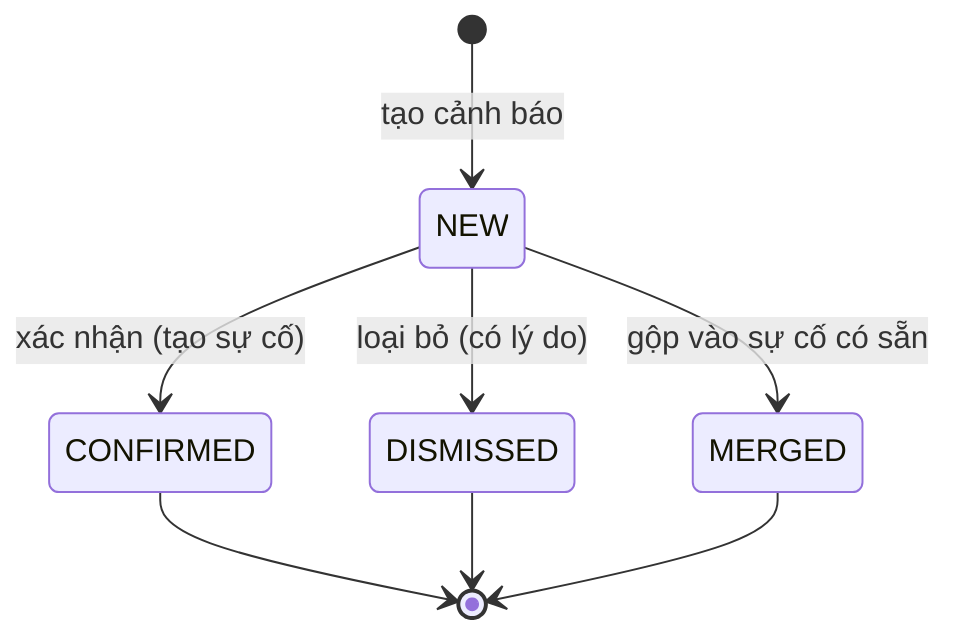
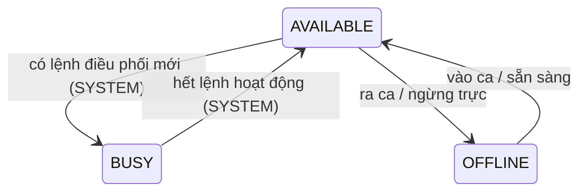
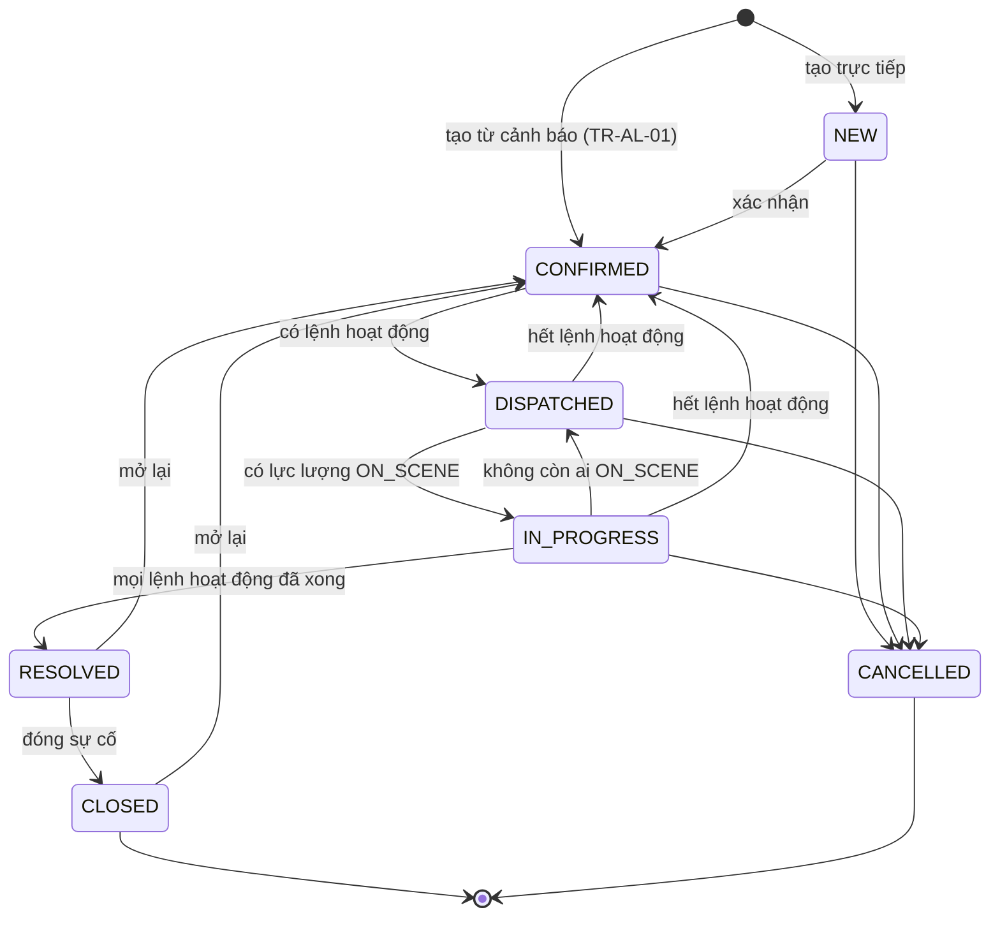
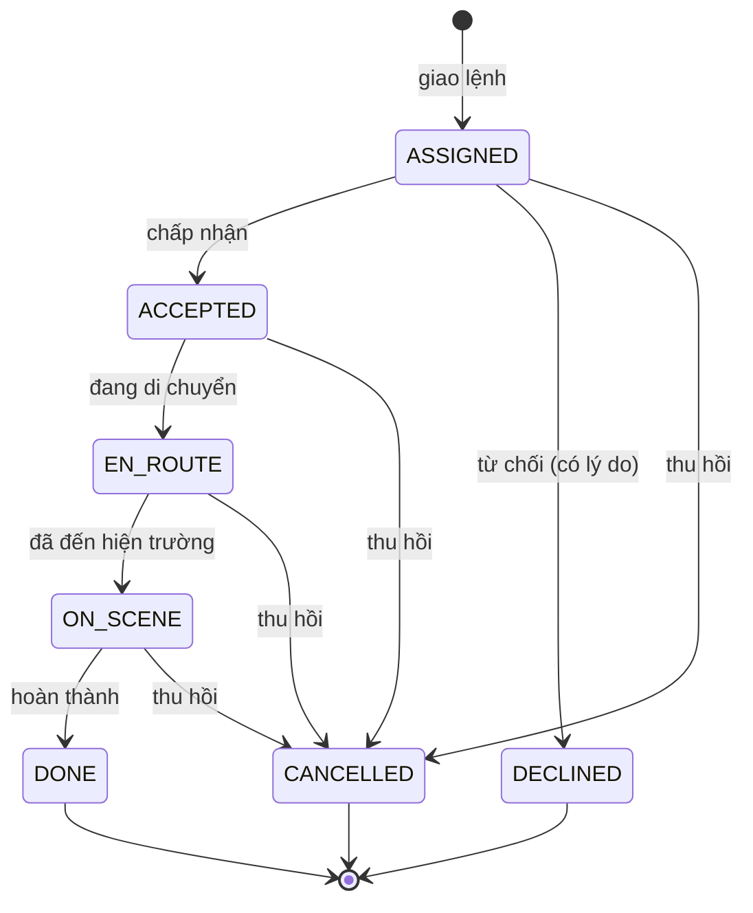

# Máy trạng thái: cảnh báo, sự cố, lệnh điều phối, lực lượng

**Đọc file này khi:** hiện thực bất kỳ thao tác nào làm đổi trạng thái (xác nhận cảnh báo, giao lệnh, cập nhật tiến độ, đóng/hủy sự cố), hoặc viết kiểm thử cho luồng nghiệp vụ.

**Nguồn yêu cầu:** [`overview.md`](../00-requirements/overview.md) mục 4 và mục 7 (BR-02 đến BR-08, BR-12), [`roles-permissions.md`](../00-requirements/roles-permissions.md) mục 3, FR-ALERT-06, FR-INC-04, FR-DISP-01 đến FR-DISP-08.
**Liên quan:** [`realtime-events.md`](realtime-events.md) (sự kiện phát ra sau mỗi chuyển trạng thái).

---

## 1. Nguyên tắc chung

1. **Một nguồn sự thật:** logic máy trạng thái và bảng chuyển trạng thái nằm trong backend (`backend/src/common/state-machine/` hoặc module tương ứng, ví dụ `modules/incidents/incident-transitions.ts`). Backend dùng nó để chặn chuyển sai; frontend nhận danh sách `allowedActions` từ backend để hiển thị các nút hợp lệ.
2. **Mọi chuyển trạng thái đi qua service**, không bao giờ `UPDATE status` trực tiếp từ controller hoặc repository.
3. **Mỗi chuyển trạng thái chạy trong một transaction** và gồm: kiểm tra quyền → kiểm tra điều kiện → cập nhật → ghi nhật ký (`incident_logs`) → cập nhật các đối tượng liên động (lực lượng, trạng thái sự cố suy ra).
4. **Phát sự kiện sau khi commit**, không phát trong transaction (xem `realtime-events.md` mục 5).
5. **Trạng thái cuối** (terminal) không có chuyển đi, trừ trường hợp mở lại sự cố (TR-IN-09).
6. **Trạng thái của sự cố được suy ra từ các lệnh điều phối** cho các bước `DISPATCHED`, `IN_PROGRESS`, `RESOLVED` (mục 4.3). Không ai đặt tay các trạng thái này.
7. **Lý do bắt buộc** (BR-02) khi: loại bỏ cảnh báo, hủy sự cố, từ chối lệnh, thu hồi lệnh, mở lại sự cố.

Ký hiệu trong các bảng: **SYSTEM** = hệ thống tự thực hiện như hệ quả của một hành động khác; **(unit)** = người dùng phải thuộc lực lượng của lệnh đó.

---

## 2. Cảnh báo (Alert)



Cảnh báo luôn được tạo ở trạng thái `NEW`, bất kể nguồn (`REPORTER`, `OPERATOR`, `AUTOMATED`).

| ID       | Từ → Sang           | Ai       | Điều kiện                                                                       | Hệ quả                                                                                                                                                        |
| -------- | ------------------- | -------- | ------------------------------------------------------------------------------- | ------------------------------------------------------------------------------------------------------------------------------------------------------------- |
| TR-AL-01 | `NEW` → `CONFIRMED` | OPERATOR | Cung cấp đủ loại sự cố, mức ưu tiên, vị trí (lấy từ cảnh báo hoặc nhập bổ sung) | Tạo sự cố ở trạng thái **`CONFIRMED`** (bước xác minh chính là hành động này); gán `alert.incidentId`; ghi nhật ký; phát `alert.resolved`, `incident.created` |
| TR-AL-02 | `NEW` → `DISMISSED` | OPERATOR | Bắt buộc có lý do                                                               | Lưu lý do; ghi nhận thời điểm xử lý; phát `alert.resolved`                                                                                                    |
| TR-AL-03 | `NEW` → `MERGED`    | OPERATOR | Sự cố đích đang ở `NEW`, `CONFIRMED`, `DISPATCHED` hoặc `IN_PROGRESS`           | Gán `alert.incidentId` = sự cố đích; ghi nhật ký trên sự cố đích; phát `alert.resolved`, `incident.updated`                                                   |

**Lưu ý:**

- Nút "Lưu và xác nhận" khi OPERATOR nhập tay (FR-ALERT-02) là **hai chuyển trạng thái liên tiếp trong cùng một request**: tạo cảnh báo `NEW` rồi TR-AL-01. Cả hai đều được ghi nhật ký.
- Cảnh báo từ nguồn tự động có thể mang loại và mức ưu tiên đề xuất (BR-14), nhưng vẫn phải đi qua TR-AL-01.
- Đồng hồ SLA xác nhận chạy từ `receivedAt` đến lúc cảnh báo rời `NEW` (mục 8).

---

## 3. Lực lượng (Unit)



| ID       | Từ → Sang               | Ai                                           | Điều kiện                                                                       |
| -------- | ----------------------- | -------------------------------------------- | ------------------------------------------------------------------------------- |
| TR-UN-01 | `AVAILABLE` → `BUSY`    | SYSTEM                                       | Khi tạo lệnh điều phối cho lực lượng (TR-DP-01)                                 |
| TR-UN-02 | `BUSY` → `AVAILABLE`    | SYSTEM                                       | Khi lực lượng không còn lệnh hoạt động nào (mục 5, bước "giải phóng lực lượng") |
| TR-UN-03 | `AVAILABLE` → `OFFLINE` | RESPONDER (unit), OPERATOR, COMMANDER, ADMIN | Lực lượng không có lệnh hoạt động                                               |
| TR-UN-04 | `OFFLINE` → `AVAILABLE` | RESPONDER (unit), OPERATOR, COMMANDER, ADMIN | —                                                                               |

- `BUSY` → `OFFLINE` **không được phép** (lỗi `UNIT_HAS_ACTIVE_DISPATCH`): phải hoàn thành hoặc thu hồi lệnh trước.
- Mỗi lực lượng có **tối đa một lệnh hoạt động** tại một thời điểm (hệ quả của BR-06 và BR-07). Việc ghi đè (FR-DISP-10) thuộc mức Could và chưa nằm trong MVP.

---

## 4. Sự cố (Incident)

### 4.1 Sơ đồ



### 4.2 Bảng chuyển trạng thái

**Chuyển thủ công** (do người dùng yêu cầu):

| ID       | Từ → Sang                                                        | Ai                  | Điều kiện                                | Hệ quả                                                                                                                                   |
| -------- | ---------------------------------------------------------------- | ------------------- | ---------------------------------------- | ---------------------------------------------------------------------------------------------------------------------------------------- |
| TR-IN-01 | `NEW` → `CONFIRMED`                                              | OPERATOR, COMMANDER | Đã có loại, mức ưu tiên, vị trí          | Ghi `confirmedAt`; phát `incident.updated`                                                                                               |
| TR-IN-07 | `RESOLVED` → `CLOSED`                                            | OPERATOR, COMMANDER | Đã nhập kết quả xử lý (`resolutionNote`) | Ghi `closedAt`; thông báo cho người báo cáo; phát `incident.updated`                                                                     |
| TR-IN-08 | `NEW` / `CONFIRMED` / `DISPATCHED` / `IN_PROGRESS` → `CANCELLED` | OPERATOR, COMMANDER | Bắt buộc có lý do                        | Thu hồi mọi lệnh hoạt động (mục 5); giải phóng lực lượng; ghi `cancelledAt`; phát `incident.updated`, `dispatch.updated`, `unit.updated` |
| TR-IN-09 | `RESOLVED` / `CLOSED` → `CONFIRMED` | COMMANDER | Bắt buộc có lý do | Xóa `resolvedAt`/`closedAt`; không đổi lệnh điều phối cũ; ghi nhật ký; phát `incident.updated` |

**Chuyển tự động** (hệ thống suy ra sau mỗi thay đổi của lệnh điều phối, xem mục 4.3):

| ID       | Từ → Sang                                  | Khi nào                                                                                                       |
| -------- | ------------------------------------------ | ------------------------------------------------------------------------------------------------------------- |
| TR-IN-02 | `CONFIRMED` → `DISPATCHED`                 | Tạo lệnh điều phối đầu tiên (người thực hiện là OPERATOR/COMMANDER giao lệnh)                                 |
| TR-IN-03 | `DISPATCHED` → `IN_PROGRESS`               | Có lệnh chuyển sang `ON_SCENE`                                                                                |
| TR-IN-04 | `IN_PROGRESS` → `RESOLVED`                 | Không còn lệnh hoạt động và có ít nhất một lệnh `DONE`                                                        |
| TR-IN-05 | `DISPATCHED` / `IN_PROGRESS` → `CONFIRMED` | Không còn lệnh hoạt động và chưa có lệnh `DONE` nào (ví dụ lực lượng từ chối, BR-08)                          |
| TR-IN-06 | `IN_PROGRESS` → `DISPATCHED`               | Còn lệnh hoạt động nhưng không còn lệnh `ON_SCENE`/`DONE` (ví dụ lệnh duy nhất đang ở hiện trường bị thu hồi) |

> TR-IN-05 và TR-IN-06 là phần **bổ sung** so với bảng gốc trong yêu cầu, cần thiết để thực hiện FR-DISP-06 ("đưa sự cố về trạng thái chờ điều phối thêm") và FR-DISP-07. Bảng ở `roles-permissions.md` mục 3 đã được cập nhật tương ứng.

### 4.3 Quy tắc suy ra trạng thái từ lệnh điều phối

Gọi **lệnh hoạt động** là lệnh có trạng thái `ASSIGNED`, `ACCEPTED`, `EN_ROUTE` hoặc `ON_SCENE`. Lệnh `DONE`, `DECLINED`, `CANCELLED` là lệnh đã kết thúc.

Sau mỗi thay đổi của một lệnh (tạo, đổi trạng thái, thu hồi), nếu sự cố đang ở `CONFIRMED`, `DISPATCHED` hoặc `IN_PROGRESS`, tính lại trạng thái bằng hàm thuần sau (đặt trong `backend/src/modules/incidents/derive-incident-status.ts`, có kiểm thử riêng):

```ts
export function deriveIncidentStatus(
  dispatches: { status: DispatchStatus }[],
): IncidentStatus {
  const active = dispatches.filter((d) =>
    ACTIVE_DISPATCH_STATUSES.includes(d.status),
  );
  const hasDone = dispatches.some((d) => d.status === DispatchStatus.DONE);
  const hasOnScene = dispatches.some(
    (d) => d.status === DispatchStatus.ON_SCENE,
  );

  if (active.length === 0) {
    return hasDone ? IncidentStatus.RESOLVED : IncidentStatus.CONFIRMED;
  }
  return hasOnScene || hasDone
    ? IncidentStatus.IN_PROGRESS
    : IncidentStatus.DISPATCHED;
}
```

Bảng kiểm tra nhanh:

| Các lệnh hiện có              | Trạng thái suy ra |
| ----------------------------- | ----------------- |
| (không có lệnh)               | `CONFIRMED`       |
| A: `ASSIGNED`                 | `DISPATCHED`      |
| A: `ON_SCENE`                 | `IN_PROGRESS`     |
| A: `DONE`, B: `EN_ROUTE`      | `IN_PROGRESS`     |
| A: `DONE`, B: `DONE`          | `RESOLVED`        |
| A: `DONE`, B: `CANCELLED`     | `RESOLVED`        |
| A: `DECLINED`                 | `CONFIRMED`       |
| A: `DECLINED`, B: `ASSIGNED`  | `DISPATCHED`      |
| A: `CANCELLED` (chưa ai xong) | `CONFIRMED`       |

**Phạm vi áp dụng:**

- Chỉ chạy khi sự cố đang ở `CONFIRMED`, `DISPATCHED` hoặc `IN_PROGRESS`. Sự cố `NEW`, `RESOLVED`, `CLOSED`, `CANCELLED` không bị hàm này thay đổi.
- Chỉ chạy khi có thay đổi ở lệnh điều phối, **không** chạy ngay khi mở lại sự cố (TR-IN-09).
- Nếu kết quả bằng trạng thái hiện tại thì không làm gì (không ghi nhật ký, không phát sự kiện).

### 4.4 Chỉnh sửa theo trạng thái

| Trạng thái                               | Sửa loại / mức ưu tiên / vị trí / mô tả | Tạo lệnh điều phối mới      | Ghi chú, ảnh         |
| ---------------------------------------- | --------------------------------------- | --------------------------- | -------------------- |
| `NEW`                                    | Có                                      | Không (phải xác nhận trước) | Có                   |
| `CONFIRMED`, `DISPATCHED`, `IN_PROGRESS` | Có                                      | Có                          | Có                   |
| `RESOLVED`                               | Không                                   | Không (phải mở lại)         | Chỉ `resolutionNote` |
| `CLOSED`, `CANCELLED`                    | Không                                   | Không                       | Không                |

Đổi mức ưu tiên sau khi tạo phải kèm lý do và ghi nhật ký (BR-12). Sửa loại/vị trí cũng ghi nhật ký giá trị cũ → mới.

---

## 5. Lệnh điều phối (Dispatch)



| ID       | Từ → Sang                                                       | Ai                                                 | Điều kiện                                                                                               | Hệ quả                                                                                                                                                                                                                 |
| -------- | --------------------------------------------------------------- | -------------------------------------------------- | ------------------------------------------------------------------------------------------------------- | ---------------------------------------------------------------------------------------------------------------------------------------------------------------------------------------------------------------------- |
| TR-DP-01 | (tạo) → `ASSIGNED`                                              | OPERATOR, COMMANDER                                | Sự cố ở `CONFIRMED`/`DISPATCHED`/`IN_PROGRESS`; lực lượng `AVAILABLE`; lực lượng chưa có lệnh hoạt động | Lực lượng → `BUSY` (TR-UN-01); suy ra lại trạng thái sự cố; phát `dispatch.assigned` (tới lực lượng) và `dispatch.updated`, `unit.updated`, `incident.updated` (tới điều hành); tạo thông báo cho thành viên lực lượng |
| TR-DP-02 | `ASSIGNED` → `ACCEPTED`                                         | RESPONDER (unit)                                   | —                                                                                                       | Ghi `acceptedAt`; phát `dispatch.updated`                                                                                                                                                                              |
| TR-DP-03 | `ASSIGNED` → `DECLINED`                                         | RESPONDER (unit)                                   | Bắt buộc có lý do                                                                                       | Giải phóng lực lượng; suy ra lại trạng thái sự cố (BR-08: **không tự giao lại**); thông báo OPERATOR                                                                                                                   |
| TR-DP-04 | `ACCEPTED` → `EN_ROUTE`                                         | RESPONDER (unit)                                   | —                                                                                                       | Ghi `enRouteAt`                                                                                                                                                                                                        |
| TR-DP-05 | `EN_ROUTE` → `ON_SCENE`                                         | RESPONDER (unit)                                   | —                                                                                                       | Ghi `onSceneAt`; ghi `firstOnSceneAt` của sự cố nếu là lần đầu; suy ra lại trạng thái sự cố (→ `IN_PROGRESS`)                                                                                                          |
| TR-DP-06 | `ON_SCENE` → `DONE`                                             | RESPONDER (unit)                                   | Có thể kèm ghi chú kết quả                                                                              | Ghi `doneAt`; giải phóng lực lượng; suy ra lại trạng thái sự cố (có thể → `RESOLVED`)                                                                                                                                  |
| TR-DP-07 | `ASSIGNED` / `ACCEPTED` / `EN_ROUTE` / `ON_SCENE` → `CANCELLED` | OPERATOR, COMMANDER (hoặc SYSTEM khi sự cố bị hủy) | Bắt buộc có lý do                                                                                       | Giải phóng lực lượng; suy ra lại trạng thái sự cố; thông báo cho lực lượng                                                                                                                                             |

**Quy tắc:**

- Các bước `ACCEPTED → EN_ROUTE → ON_SCENE → DONE` phải đi **tuần tự**, không nhảy cóc.
- Chỉ lệnh ở `ASSIGNED` mới được từ chối. Đã chấp nhận rồi thì chỉ có thể tiếp tục hoặc bị OPERATOR thu hồi.
- **Giải phóng lực lượng:** sau khi lệnh kết thúc (`DONE`, `DECLINED`, `CANCELLED`), nếu lực lượng không còn lệnh hoạt động nào thì chuyển `AVAILABLE` (TR-UN-02).
- Một sự cố có thể có nhiều lệnh; một lực lượng không được có hai lệnh hoạt động cùng lúc.
- **Điều phối thủ công (BR-15):** Lệnh điều phối (`TR-DP-01`) chỉ được tạo khi `OPERATOR` hoặc `COMMANDER` chủ động chọn lực lượng và gửi yêu cầu giao lệnh; hệ thống không tự động điều phối khi xác nhận cảnh báo/sự cố.
- Lực lượng gợi ý theo `FR-DISP-01` (ưu tiên theo thứ tự `suggested_unit_types` của loại sự cố, ví dụ `FIRE` ưu tiên gợi ý `FIRE_FIGHTING` trước các lực lượng hỗ trợ và sắp xếp theo cự ly Haversine) chỉ mang tính hỗ trợ quyết định. Backend **không bắt buộc** đúng loại lực lượng gợi ý (cho phép chọn thủ công lực lượng khác loại nếu đội chuyên môn bận), nhưng bắt buộc lực lượng được chọn phải đang `AVAILABLE`.

---

## 6. Hệ quả dây chuyền (cascade)

| Khi xảy ra                           | Hệ thống làm thêm                                                                                                              |
| ------------------------------------ | ------------------------------------------------------------------------------------------------------------------------------ |
| Sự cố bị hủy (TR-IN-08)              | Chuyển mọi lệnh hoạt động sang `CANCELLED` (lý do: "Sự cố bị hủy: <lý do>"), giải phóng các lực lượng, thông báo cho lực lượng |
| Lực lượng từ chối lệnh (TR-DP-03)    | Suy ra lại trạng thái sự cố; **không** tự chọn lực lượng khác; thông báo OPERATOR kèm lý do                                    |
| Lệnh cuối cùng hoàn thành (TR-DP-06) | Sự cố → `RESOLVED`; thông báo OPERATOR để xác nhận đóng                                                                        |
| Sự cố đóng (TR-IN-07)                | Thông báo người báo cáo (nếu có)                                                                                               |
| Cảnh báo bị loại bỏ hoặc gộp         | Thông báo người báo cáo nếu cảnh báo do họ gửi                                                                                 |
| Sự cố mở lại (TR-IN-09)              | Không thay đổi lệnh hay lực lượng; OPERATOR phải giao lệnh mới nếu cần                                                         |

---

## 7. Dữ liệu ghi nhận ở mỗi chuyển trạng thái

**Nhật ký (`incident_logs`)**, bất biến (FR-LOG-02), mỗi dòng gồm:

| Trường       | Ý nghĩa                                                                                                                    |
| ------------ | -------------------------------------------------------------------------------------------------------------------------- |
| `incidentId` | Sự cố liên quan                                                                                                            |
| `actorId`    | Người thực hiện (`null` nếu là hệ thống)                                                                                   |
| `actorType`  | `USER` hoặc `SYSTEM`                                                                                                       |
| `action`     | Ví dụ `STATUS_CHANGED`, `FIELD_UPDATED`, `DISPATCH_CREATED`, `DISPATCH_STATUS_CHANGED`, `ALERT_MERGED`, `ATTACHMENT_ADDED` |
| `from`, `to` | Giá trị cũ và mới (trạng thái hoặc giá trị trường)                                                                         |
| `reason`     | Lý do (nếu bắt buộc)                                                                                                       |
| `metadata`   | JSON: id lệnh, id lực lượng, id cảnh báo...                                                                                |
| `createdAt`  | Thời điểm                                                                                                                  |

**Mốc thời gian** (phục vụ SLA và thống kê FR-DASH-04):

| Đối tượng | Trường                                                                                                                 |
| --------- | ---------------------------------------------------------------------------------------------------------------------- |
| Alert     | `receivedAt`, `handledAt` (lúc rời `NEW`), `confirmSlaBreachedAt`                                                      |
| Incident  | `confirmedAt`, `firstDispatchedAt`, `firstOnSceneAt`, `resolvedAt`, `closedAt`, `cancelledAt`, `dispatchSlaBreachedAt` |
| Dispatch  | `assignedAt`, `acceptedAt`, `enRouteAt`, `onSceneAt`, `doneAt`, `declinedAt`, `cancelledAt`                            |

Các khoảng thời gian cho dashboard: nhận → xác nhận (`receivedAt` → `confirmedAt`), xác nhận → điều phối (`confirmedAt` → `firstDispatchedAt`), điều phối → đến nơi (`firstDispatchedAt` → `firstOnSceneAt`), đến nơi → hoàn thành (`firstOnSceneAt` → `resolvedAt`).

Với sự cố tạo trực tiếp (không từ cảnh báo), mốc nhận lấy bằng `createdAt`.

---

## 8. SLA

Bảng SLA nằm ở [`overview.md`](../00-requirements/overview.md) mục 5.2. MVP đặt hằng số trong `backend/src/modules/sla/sla.constants.ts`; cấu hình động (FR-ADMIN-03) để sau.

| SLA       | Bắt đầu                | Kết thúc                                        | Cờ vi phạm                       |
| --------- | ---------------------- | ----------------------------------------------- | -------------------------------- |
| Xác nhận  | `alert.receivedAt`     | Cảnh báo rời `NEW` (xác nhận, loại bỏ hoặc gộp) | `alert.confirmSlaBreachedAt`     |
| Điều phối | `incident.confirmedAt` | `incident.firstDispatchedAt`                    | `incident.dispatchSlaBreachedAt` |

- Một **tác vụ định kỳ** (`@nestjs/schedule`, chu kỳ khoảng 30 giây) tìm các đối tượng đã quá hạn mà cờ vi phạm còn trống, đặt cờ và phát `sla.breached`. Mỗi vi phạm chỉ phát **một lần**. Không cần Redis hay BullMQ.
- Cảnh báo chưa có mức ưu tiên (BR-13) tính SLA xác nhận theo mức `MEDIUM` **[GIẢ ĐỊNH]**.
- Sự cố tạo trực tiếp ở trạng thái `NEW` chưa tính SLA điều phối; đồng hồ bắt đầu khi `CONFIRMED`.
- Mở lại sự cố không khởi động lại SLA.

---

## 9. Mã lỗi

Định dạng phản hồi lỗi: `{ "statusCode": 409, "code": "INVALID_TRANSITION", "message": "...", "details": { ... } }`.

| HTTP | `code`                      | Khi nào                                                                                               |
| ---- | --------------------------- | ----------------------------------------------------------------------------------------------------- |
| 403  | `FORBIDDEN_ROLE`            | Vai trò không được phép thực hiện hành động                                                           |
| 403  | `FORBIDDEN_SCOPE`           | Vai trò đúng nhưng ngoài phạm vi dữ liệu (không phải lực lượng của lệnh, không phải báo cáo của mình) |
| 404  | `NOT_FOUND`                 | Không tìm thấy đối tượng                                                                              |
| 409  | `INVALID_TRANSITION`        | Chuyển trạng thái không có trong bảng                                                                 |
| 409  | `UNIT_NOT_AVAILABLE`        | Giao lệnh cho lực lượng không `AVAILABLE`                                                             |
| 409  | `UNIT_HAS_ACTIVE_DISPATCH`  | Đưa lực lượng đang `BUSY` sang `OFFLINE`                                                              |
| 409  | `INCIDENT_NOT_DISPATCHABLE` | Giao lệnh cho sự cố không ở `CONFIRMED`/`DISPATCHED`/`IN_PROGRESS`                                    |
| 409  | `CONCURRENT_MODIFICATION`   | Dữ liệu vừa bị người khác thay đổi (so sánh phiên bản thất bại)                                       |
| 422  | `REASON_REQUIRED`           | Thiếu lý do bắt buộc (BR-02)                                                                          |
| 422  | `MISSING_CLASSIFICATION`    | Thiếu loại, mức ưu tiên hoặc vị trí khi xác nhận                                                      |
| 422  | `RESOLUTION_REQUIRED`       | Đóng sự cố mà chưa có kết quả xử lý                                                                   |

Lỗi kiểm tra dữ liệu đầu vào (DTO) trả `400` theo chuẩn của `ValidationPipe`.

---

## 10. Hướng dẫn hiện thực

### 10.1 Vị trí mã

Backend là nguồn sự thật cho logic máy trạng thái:

```
backend/src/
├── common/
│   ├── state-machine/
│   │   ├── transition-rule.interface.ts # kiểu TransitionRule + hàm findTransition
│   │   └── index.ts
│   └── enums/
│       ├── alert-status.enum.ts
│       ├── incident-status.enum.ts
│       ├── dispatch-status.enum.ts
│       └── unit-status.enum.ts
│
└── modules/
    ├── alerts/
    │   ├── alert-transitions.ts         # TR-AL-xx
    │   └── alerts.service.ts
    ├── incidents/
    │   ├── incident-transitions.ts      # TR-IN-xx
    │   ├── derive-incident-status.ts    # hàm thuần suy diễn trạng thái ở mục 4.3
    │   └── incidents.service.ts         # recomputeStatus()
    ├── dispatch/
    │   ├── dispatch-transitions.ts      # TR-DP-xx
    │   └── dispatch.service.ts          # điều phối toàn bộ liên động
    └── units/
        ├── unit-transitions.ts          # TR-UN-xx
        └── units.service.ts
```

Frontend giữ bản sao các enum và interface tương ứng tại `frontend/src/types/enums.ts` và render nút hành động dựa trên `incident.allowedActions` do backend trả về.

### 10.2 Dạng dữ liệu của bảng chuyển

```ts
export interface TransitionRule<S, R> {
  id: string; // 'TR-IN-07'
  from: readonly S[];
  to: S;
  roles: readonly (R | "SYSTEM")[];
  requires?: readonly ("reason" | "resolutionNote")[];
}

export const INCIDENT_TRANSITIONS: readonly TransitionRule<
  IncidentStatus,
  UserRole
>[] = [
  {
    id: "TR-IN-01",
    from: [IncidentStatus.NEW],
    to: IncidentStatus.CONFIRMED,
    roles: [UserRole.OPERATOR, UserRole.COMMANDER],
  },
  {
    id: "TR-IN-07",
    from: [IncidentStatus.RESOLVED],
    to: IncidentStatus.CLOSED,
    roles: [UserRole.OPERATOR, UserRole.COMMANDER],
    requires: ["resolutionNote"],
  },
  // ...
];

export function findTransition(from: IncidentStatus, to: IncidentStatus) {
  /* ... */
}
export function allowedNextStatuses(from: IncidentStatus, role: UserRole) {
  /* dùng cho frontend */
}
```

### 10.3 Quy trình xử lý một thay đổi lệnh điều phối

Ví dụ `DispatchService.changeStatus(dispatchId, to, actor, payload)`:

1. Mở transaction.
2. **Khóa theo thứ tự cố định: sự cố → lệnh → lực lượng** (`setLock('pessimistic_write')`). Khóa luôn theo thứ tự này để tránh deadlock khi nhiều người thao tác cùng lúc.
3. Kiểm tra quyền và phạm vi (RESPONDER có thuộc lực lượng của lệnh không).
4. Tra `findTransition`; không có thì ném `INVALID_TRANSITION`. Kiểm tra `requires` (lý do...).
5. Cập nhật lệnh và các mốc thời gian.
6. Ghi `incident_logs`.
7. Nếu lệnh kết thúc, giải phóng lực lượng (TR-UN-02).
8. Gọi `deriveIncidentStatus` với toàn bộ lệnh của sự cố; nếu khác trạng thái hiện tại thì cập nhật sự cố và ghi nhật ký (`actorType = SYSTEM`).
9. Commit.
10. **Sau commit**, phát các sự kiện nội bộ (`EventEmitter2`) để `realtime` và `notifications` xử lý.

Thao tác giao lệnh (TR-DP-01) và hủy sự cố (TR-IN-08) theo cùng khuôn mẫu, với thao tác hủy gộp thêm bước thu hồi hàng loạt các lệnh.

### 10.4 Hai việc nên làm từ đầu

- Cột `version` (TypeORM `@VersionColumn()`) trên `incidents`, `dispatches`, `units` để phát hiện thay đổi đồng thời và trả `CONCURRENT_MODIFICATION`.
- Cho `incidents.service.ts` một hàm `recomputeStatus(incidentId, manager)` dùng chung, nhận `EntityManager` của transaction đang chạy để mọi nơi gọi đều nằm trong cùng transaction.

---

## 11. Danh mục kiểm thử bắt buộc

**Kiểm thử đơn vị (hàm thuần trong `shared`)**

- `deriveIncidentStatus` đúng cho từng dòng ở bảng mục 4.3.
- `findTransition` / `allowedNextStatuses`: mọi cặp (từ, sang) hợp lệ đều được chấp nhận, mọi cặp còn lại bị từ chối.

**Kiểm thử e2e (backend)**

- Luồng chính: cảnh báo → xác nhận → giao lệnh → chấp nhận → đang đến → đến nơi → hoàn thành → `RESOLVED` → đóng.
- Từ chối lệnh: sự cố quay về `CONFIRMED`, lực lượng về `AVAILABLE`, không tự giao lại.
- Hai lực lượng: một xong, một đang xử lý thì sự cố vẫn `IN_PROGRESS`; cả hai xong thì `RESOLVED`.
- Thu hồi lệnh duy nhất đang `ON_SCENE`: sự cố về `CONFIRMED` (chưa ai xong).
- Hủy sự cố khi có lệnh hoạt động: mọi lệnh sang `CANCELLED`, lực lượng được giải phóng.
- Giao lệnh cho lực lượng `BUSY` hoặc `OFFLINE`: `UNIT_NOT_AVAILABLE`.
- Giao lệnh cho sự cố `RESOLVED`/`CLOSED`/`CANCELLED`/`NEW`: `INCIDENT_NOT_DISPATCHABLE`.
- Mỗi chuyển cần lý do thiếu lý do: `REASON_REQUIRED`.
- RESPONDER thao tác lệnh của lực lượng khác: `FORBIDDEN_SCOPE`.
- REPORTER cố xác nhận cảnh báo: `FORBIDDEN_ROLE`.
- Đóng sự cố thiếu `resolutionNote`: `RESOLUTION_REQUIRED`.
- Hai request đồng thời cùng giao lệnh cho một lực lượng: chỉ một thành công.
- Mở lại sự cố đã đóng bởi COMMANDER thành công, bởi OPERATOR bị từ chối.
- Mọi chuyển trạng thái đều sinh đúng một dòng nhật ký và đúng sự kiện sau commit.

---

## 12. Điểm cần nhóm xác nhận

| #   | Nội dung                                                                                                                            | Mặc định đang dùng                 |
| --- | ----------------------------------------------------------------------------------------------------------------------------------- | ---------------------------------- |
| 1   | Sự cố tạo từ cảnh báo bắt đầu ở `CONFIRMED`; sự cố tạo trực tiếp bắt đầu ở `NEW`                                                    | Như mô tả ở mục 2 và 4             |
| 2   | Mở lại sự cố quay về trạng thái nào (A-09)                                                          | Đã chốt: Chuyển về `CONFIRMED` để Operator giao lệnh mới |
| 3   | SLA xác nhận cho cảnh báo chưa có mức ưu tiên                                                                                       | Tính theo `MEDIUM`                 |
| 4   | COMMANDER cũng được xác nhận sự cố `NEW` (TR-IN-01), do COMMANDER có quyền tạo sự cố trực tiếp                                      | Cho phép                           |
| 5   | Mỗi lực lượng tối đa một lệnh hoạt động; chưa có tính năng ghi đè                                                                   | Như mục 3                          |
| 6   | Lệnh chỉ được từ chối ở trạng thái `ASSIGNED`                                                                                       | Như mục 5                          |
