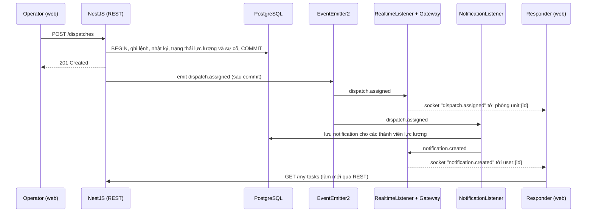

# Sự kiện thời gian thực (Socket.IO)

**Đọc file này khi:** làm module `realtime` và `notifications` ở backend, `SocketProvider` ở frontend, hoặc thêm bất kỳ chức năng nào cần đẩy dữ liệu tức thì.

**Nguồn yêu cầu:** [`overview.md`](../00-requirements/overview.md) mục 6 (bảng sự kiện), FR-RT-01 đến FR-RT-05, FR-NOTI-01 đến FR-NOTI-03, NFR-05, NFR-06, BR-09.
**Liên quan:** [`incident-state-machine.md`](incident-state-machine.md) (khi nào sự kiện được phát).

---

## 1. Nguyên tắc thiết kế

1. **REST là nguồn sự thật, socket chỉ báo "có thay đổi".** Payload nhỏ gọn (id, trạng thái, vài trường tóm tắt). Client nhận sự kiện thì làm mới dữ liệu qua REST. Nhờ vậy mất kết nối hay lỡ một sự kiện cũng không làm sai dữ liệu (NFR-06).
2. **Chỉ phát sau khi commit.** Service ghi DB xong, commit, rồi mới phát sự kiện nội bộ. Không phát trong transaction, tránh client nhận sự kiện về dữ liệu chưa tồn tại hoặc bị rollback.
3. **Tách module nghiệp vụ khỏi socket.** Module nghiệp vụ chỉ phát **sự kiện nội bộ** (`EventEmitter2`). Module `realtime` lắng nghe và quyết định gửi cho ai. Module `notifications` lắng nghe và lưu thông báo. Module nghiệp vụ không import `RealtimeGateway`.
4. **Phát theo phòng (room), không phát toàn bộ.** Mỗi người chỉ nhận sự kiện liên quan đến vai trò và phạm vi của mình.
5. **Không gửi dữ liệu nhạy cảm qua socket.** Payload không chứa thông tin liên hệ người báo cáo, nội dung mô tả đầy đủ hay ảnh (BR-09). Client cần chi tiết thì gọi REST, nơi quyền được kiểm tra đầy đủ.
6. **Ít nhất một lần, không đảm bảo thứ tự tuyệt đối.** Client xử lý sự kiện theo kiểu "làm mới", nên nhận trùng hay đảo thứ tự không gây hại.

---

## 2. Kết nối và xác thực

| Hạng mục                            | Quy định                                                                                                                                                        |
| ----------------------------------- | --------------------------------------------------------------------------------------------------------------------------------------------------------------- |
| Thư viện                            | `socket.io` (server, qua `@nestjs/websockets` + `@nestjs/platform-socket.io`), `socket.io-client` (web)                                                         |
| Địa chỉ                             | Cùng host backend, đường dẫn mặc định `/socket.io`; namespace mặc định `/`                                                                                      |
| CORS                                | Chỉ cho phép origin trong biến môi trường `CORS_ORIGIN`                                                                                                         |
| Xác thực                            | Client gửi access token qua `io(url, { auth: { token } })`. Server kiểm tra JWT ở middleware lúc handshake; sai hoặc hết hạn thì từ chối với lỗi `UNAUTHORIZED` |
| Token hết hạn khi đang kết nối      | Server hẹn giờ theo `exp` của token và ngắt kết nối khi tới hạn. Client làm mới token (refresh) rồi kết nối lại với token mới                                   |
| Người dùng bị khóa hoặc đổi vai trò | Server gọi `io.in('user:{id}').disconnectSockets()`; client tự kết nối lại và nhận các phòng mới                                                                |
| Nhiều tab/thiết bị                  | Cho phép; mỗi kết nối vào cùng các phòng của người dùng                                                                                                         |
| Triển khai                          | Một instance backend, **không cần Redis adapter**. Nếu sau này chạy nhiều instance thì mới thêm                                                                 |

Không có sự kiện từ client lên server trong MVP, ngoại trừ các sự kiện hệ thống của Socket.IO. Mọi hành động nghiệp vụ đi qua REST.

---

## 3. Phòng (rooms)

Khi kết nối thành công, server tự cho socket vào các phòng sau, suy ra từ token và dữ liệu người dùng:

| Phòng           | Ai vào                                                  | Dùng để                                               |
| --------------- | ------------------------------------------------------- | ----------------------------------------------------- |
| `user:{userId}` | Mọi người dùng                                          | Thông báo cá nhân; cập nhật báo cáo của người báo cáo |
| `role:{ROLE}`   | Mọi người dùng, ví dụ `role:OPERATOR`, `role:COMMANDER` | Phát cho cả nhóm điều hành                            |
| `unit:{unitId}` | RESPONDER thuộc lực lượng đó                            | Lệnh điều phối và cập nhật sự cố của lực lượng        |

Tên phòng tạo bằng các hàm trong `backend/src/modules/realtime/rooms.ts` (ví dụ `Rooms.user(id)`, `Rooms.role(role)`, `Rooms.unit(id)`), không viết chuỗi trực tiếp ở nhiều nơi.

Không có phòng theo từng sự cố trong MVP: người xem chi tiết sự cố là OPERATOR/COMMANDER (đã ở phòng vai trò) hoặc RESPONDER (đã ở phòng lực lượng). Thêm phòng `incident:{id}` sau này nếu cần.

> Khi gửi cho nhiều phòng trong cùng một lần phát (`io.to(a).to(b).emit(...)`), Socket.IO chỉ gửi **một lần** cho mỗi socket dù socket thuộc nhiều phòng đó. Luôn dùng cách nối `.to()` thay vì phát từng phòng riêng.

---

## 4. Danh mục sự kiện

### 4.1 Quy ước

- Tên sự kiện: `đối-tượng.hành-động`, chữ thường, ngăn cách bằng dấu chấm. Khai báo hằng số tại `backend/src/modules/realtime/events/socket-events.ts` (phía backend) và sao chép kiểu payload tại `frontend/src/types/socket-events.ts` (phía frontend).
- Mọi payload có hai trường chung: `eventId` (UUID, để client bỏ qua trùng) và `occurredAt` (ISO 8601, UTC).
- Payload tóm tắt, **không** chứa dữ liệu nhạy cảm. Chi tiết lấy qua REST.

```ts
interface BaseEventPayload {
  eventId: string;
  occurredAt: string;
}
```

### 4.2 Bảng người nhận

| Sự kiện                | Phòng nhận                                                                                                           | Ghi chú                                                            |
| ---------------------- | -------------------------------------------------------------------------------------------------------------------- | ------------------------------------------------------------------ |
| `alert.created`        | `role:OPERATOR`, `role:COMMANDER`                                                                                    |                                                                    |
| `alert.resolved`       | `role:OPERATOR`, `role:COMMANDER`, `user:{reporterId}` (nếu có)                                                      | Người báo cáo biết báo cáo của mình được xác nhận, loại bỏ hay gộp |
| `incident.created`     | `role:OPERATOR`, `role:COMMANDER`                                                                                    |                                                                    |
| `incident.updated`     | `role:OPERATOR`, `role:COMMANDER`, `user:{reporterId}` của báo cáo liên quan, `unit:{unitId}` của mọi lệnh hoạt động | Payload tối thiểu, an toàn cho mọi người nhận                      |
| `dispatch.assigned`    | `unit:{unitId}` của lực lượng được giao                                                                              | Dùng để hiện thông báo nổi cho lực lượng                           |
| `dispatch.updated`     | `role:OPERATOR`, `role:COMMANDER`, `unit:{unitId}`                                                                   | Phát cho mọi thay đổi của lệnh, kể cả khi mới tạo                  |
| `unit.updated`         | `role:OPERATOR`, `role:COMMANDER`                                                                                    |                                                                    |
| `sla.breached`         | `role:OPERATOR`, `role:COMMANDER`                                                                                    |                                                                    |
| `notification.created` | `user:{userId}` của người nhận                                                                                       | Sau khi đã lưu vào DB                                              |

> So với bảng ở `overview.md` mục 6, `alert.resolved` có thêm người báo cáo làm người nhận, để thực hiện FR-INC-11 khi báo cáo bị loại bỏ (lúc đó không có sự cố nào để phát `incident.updated`).

### 4.3 Payload

```ts
export type AlertSource = "REPORTER" | "OPERATOR" | "AUTOMATED";

export interface AlertCreatedPayload extends BaseEventPayload {
  alertId: string;
  source: AlertSource;
  type?: IncidentTypeCode;
  priority?: IncidentPriority; // có thể chưa có (BR-13)
  location: { lat: number; lng: number };
  summary: string; // tối đa ~120 ký tự, không chứa thông tin liên hệ
  receivedAt: string;
}

export interface AlertResolvedPayload extends BaseEventPayload {
  alertId: string;
  resolution: "CONFIRMED" | "DISMISSED" | "MERGED";
  incidentId?: string; // có khi CONFIRMED hoặc MERGED
  // lý do loại bỏ KHÔNG đưa vào đây: lấy qua REST theo quyền
}

export interface IncidentCreatedPayload extends BaseEventPayload {
  incidentId: string;
  code: string; // INC-20261124-0001
  type: IncidentTypeCode;
  priority: IncidentPriority;
  status: IncidentStatus;
  location: { lat: number; lng: number };
}

export interface IncidentUpdatedPayload extends BaseEventPayload {
  incidentId: string;
  code: string;
  status: IncidentStatus;
  previousStatus?: IncidentStatus;
  changedFields: string[]; // ví dụ ['status', 'priority']
  // không chứa mức ưu tiên, mô tả, vị trí để an toàn với REPORTER; client làm mới qua REST
}

export interface DispatchAssignedPayload extends BaseEventPayload {
  dispatchId: string;
  incidentId: string;
  incidentCode: string;
  unitId: string;
  type: IncidentTypeCode;
  priority: IncidentPriority;
  location: { lat: number; lng: number };
  instruction?: string;
}

export interface DispatchUpdatedPayload extends BaseEventPayload {
  dispatchId: string;
  incidentId: string;
  unitId: string;
  status: DispatchStatus;
  previousStatus: DispatchStatus | null; // null khi mới tạo
}

export interface UnitUpdatedPayload extends BaseEventPayload {
  unitId: string;
  status: UnitStatus;
  previousStatus?: UnitStatus;
  location?: { lat: number; lng: number };
}

export interface SlaBreachedPayload extends BaseEventPayload {
  kind: "CONFIRM" | "DISPATCH";
  alertId?: string; // khi kind = CONFIRM
  incidentId?: string; // khi kind = DISPATCH
  priority: IncidentPriority;
  dueAt: string;
  overdueMinutes: number;
}

export interface NotificationCreatedPayload extends BaseEventPayload {
  notificationId: string;
  type: NotificationType;
  title: string;
  body?: string;
  link?: string; // đường dẫn trong ứng dụng, ví dụ /incidents/{id}
}
```

---

## 5. Luồng từ nghiệp vụ tới màn hình



### 5.1 Sự kiện nội bộ

Dùng chung tên với sự kiện socket để dễ truy vết, khai báo ở `backend/src/common/events/domain-events.ts`:

```ts
export const DomainEvents = {
  ALERT_CREATED: "alert.created",
  ALERT_RESOLVED: "alert.resolved",
  INCIDENT_CREATED: "incident.created",
  INCIDENT_UPDATED: "incident.updated",
  DISPATCH_ASSIGNED: "dispatch.assigned",
  DISPATCH_UPDATED: "dispatch.updated",
  UNIT_UPDATED: "unit.updated",
  SLA_BREACHED: "sla.breached",
} as const;
```

`notification.created` **không** là sự kiện nội bộ của nghiệp vụ: nó do `NotificationsService` phát sau khi lưu thông báo.

### 5.2 Khung hiện thực ở backend

```ts
// modules/realtime/realtime.listener.ts
@Injectable()
export class RealtimeListener {
  constructor(private readonly gateway: RealtimeGateway) {}

  @OnEvent(DomainEvents.DISPATCH_ASSIGNED)
  onDispatchAssigned(e: DispatchAssignedEvent) {
    this.gateway.emitTo([Rooms.unit(e.unitId)], 'dispatch.assigned', toPayload(e));
  }

  @OnEvent(DomainEvents.INCIDENT_UPDATED)
  async onIncidentUpdated(e: IncidentUpdatedEvent) {
    const rooms = [
      Rooms.role(UserRole.OPERATOR),
      Rooms.role(UserRole.COMMANDER),
      ...e.reporterIds.map(Rooms.user),
      ...e.activeUnitIds.map(Rooms.unit),
    ];
    this.gateway.emitTo(rooms, 'incident.updated', toPayload(e));
  }
}

// modules/realtime/realtime.gateway.ts
emitTo(rooms: string[], event: string, payload: unknown) {
  rooms.reduce((op, room) => op.to(room), this.server as any).emit(event, payload);
}
```

Người phát sự kiện nội bộ phải **đính kèm sẵn** danh sách người nhận cần tra cứu (`reporterIds`, `activeUnitIds`) trong dữ liệu sự kiện, lấy lúc còn trong transaction. Listener không truy vấn lại DB để tránh đọc dữ liệu đã đổi.

### 5.3 Thông báo lưu DB (FR-NOTI)

`NotificationListener` lưu bản ghi vào `notifications` **trước**, rồi mới phát `notification.created` (FR-NOTI-01). Người dùng ngoại tuyến vẫn thấy thông báo khi đăng nhập lại (FR-NOTI-03).

| Sự kiện nghiệp vụ                              | Người nhận                           | Loại thông báo        |
| ---------------------------------------------- | ------------------------------------ | --------------------- |
| `alert.created` với mức `CRITICAL` hoặc `HIGH` | Mọi OPERATOR                         | `ALERT_HIGH_PRIORITY` |
| `dispatch.assigned`                            | Thành viên (RESPONDER) của lực lượng | `DISPATCH_ASSIGNED`   |
| Lệnh bị từ chối                                | Mọi OPERATOR                         | `DISPATCH_DECLINED`   |
| Lệnh bị thu hồi hoặc sự cố bị hủy              | Thành viên lực lượng liên quan       | `DISPATCH_CANCELLED`  |
| Sự cố sang `RESOLVED`                          | Mọi OPERATOR                         | `INCIDENT_RESOLVED`   |
| Sự cố `CLOSED`, cảnh báo bị loại bỏ hoặc gộp   | Người báo cáo (nếu có)               | `REPORT_UPDATED`      |
| `sla.breached`                                 | Mọi OPERATOR, COMMANDER              | `SLA_BREACHED`        |

### 5.4 Sự kiện `sla.breached`

Phát bởi tác vụ định kỳ của module `sla` (xem `incident-state-machine.md` mục 8), mỗi vi phạm một lần. Không dùng hàng đợi.

---

## 6. Phía frontend

### 6.1 Vị trí mã

```
frontend/src/
├── providers/SocketProvider.tsx          # tạo kết nối, đăng ký lắng nghe
└── lib/
    ├── socket.ts                         # tạo socket, gắn token
    ├── query-keys.ts                     # khóa TanStack Query dùng chung
    └── realtime/
        ├── event-handlers.ts             # sự kiện -> làm mới dữ liệu nào
        └── notify.ts                     # toast, âm báo
```

### 6.2 Sự kiện làm mới dữ liệu nào

Mặc định mỗi sự kiện chỉ gọi `queryClient.invalidateQueries` cho các khóa liên quan; TanStack Query sẽ tự tải lại các truy vấn đang hiển thị.

| Sự kiện                | Khóa truy vấn làm mới                                                                                   | Hiệu ứng giao diện                             |
| ---------------------- | ------------------------------------------------------------------------------------------------------- | ---------------------------------------------- |
| `alert.created`        | `['alerts']`, `['dashboard']`                                                                           | Toast; âm báo nếu `CRITICAL`/`HIGH` (FR-RT-05) |
| `alert.resolved`       | `['alerts']`, `['reports']`, `['dashboard']`                                                            | —                                              |
| `incident.created`     | `['incidents']`, `['map']`, `['dashboard']`                                                             | —                                              |
| `incident.updated`     | `['incidents']`, `['incidents', incidentId]`, `['map']`, `['my-tasks']`, `['reports']`, `['dashboard']` | —                                              |
| `dispatch.assigned`    | `['my-tasks']`                                                                                          | Toast nổi bật cho lực lượng                    |
| `dispatch.updated`     | `['incidents', incidentId]`, `['my-tasks']`, `['units']`, `['map']`                                     | —                                              |
| `unit.updated`         | `['units']`, `['map']`                                                                                  | —                                              |
| `sla.breached`         | `['alerts']`, `['incidents']`, `['dashboard']`                                                          | Banner cảnh báo giữ lại đến khi xử lý          |
| `notification.created` | `['notifications']`                                                                                     | Tăng số chưa đọc trên chuông                   |

### 6.3 Quy tắc ở client

- **Gộp làm mới (debounce ~300 ms)** theo từng khóa truy vấn. Công cụ giả lập có thể bắn nhiều cảnh báo liên tiếp; không để mỗi sự kiện kích hoạt một lần tải lại.
- **Bỏ qua sự kiện trùng** bằng `eventId` (giữ một tập nhỏ các id gần nhất).
- **Kết nối lại:** mỗi lần `connect` (kể cả kết nối lại), gọi `queryClient.invalidateQueries()` cho các truy vấn đang hoạt động để đồng bộ phần bỏ lỡ (FR-RT-03). Server không phát lại sự kiện cũ.
- **Hiển thị trạng thái kết nối** (FR-RT-04): lắng nghe `connect`, `disconnect`, `connect_error` rồi cập nhật badge ở header (đã kết nối / đang kết nối lại / mất kết nối).
- **Lỗi xác thực khi kết nối:** thử làm mới token một lần; nếu vẫn lỗi thì đăng xuất.
- **Sau khi làm mới token:** cập nhật `socket.auth = { token }` rồi `socket.disconnect().connect()`.
- Chỉ kết nối socket khi đã đăng nhập, ngắt khi đăng xuất.

---

## 7. Cấu hình và biến môi trường

| Biến                         | Nơi dùng | Ý nghĩa                                  |
| ---------------------------- | -------- | ---------------------------------------- |
| `NEXT_PUBLIC_SOCKET_URL`     | web      | Địa chỉ Socket.IO server                 |
| `CORS_ORIGIN`                | backend  | Origin được phép kết nối                 |
| `JWT_ACCESS_SECRET`          | backend  | Khóa xác minh token lúc handshake        |
| `SLA_CHECK_INTERVAL_SECONDS` | backend  | Chu kỳ tác vụ kiểm tra SLA (mặc định 30) |

---

## 8. Kiểm thử

**Backend (e2e với `socket.io-client`)**

- Kết nối không token hoặc token sai: bị từ chối.
- Mỗi vai trò vào đúng phòng: OPERATOR nhận `alert.created`; RESPONDER **không** nhận.
- `dispatch.assigned` chỉ tới đúng lực lượng được giao; lực lượng khác không nhận.
- REPORTER chỉ nhận `incident.updated` và `alert.resolved` của báo cáo mình, không nhận của người khác.
- Payload không chứa trường nhạy cảm (thông tin liên hệ, mô tả đầy đủ).
- Sự kiện chỉ phát **sau commit**: giả lập lỗi trong transaction thì không có sự kiện nào được phát.
- Mỗi socket chỉ nhận một lần khi thuộc nhiều phòng đích.
- Người dùng bị khóa thì socket bị ngắt.
- Token hết hạn thì socket bị ngắt.
- `notification.created` chỉ phát sau khi bản ghi đã lưu.

**Frontend**

- Nhận sự kiện làm mới đúng khóa truy vấn (kiểm thử đơn vị bảng `event-handlers`).
- Nhận nhiều sự kiện liên tiếp chỉ gây một lần tải lại (debounce).
- Mất kết nối rồi kết nối lại thì dữ liệu được đồng bộ.

---

## 9. Điểm cần nhóm xác nhận

| #   | Nội dung                                                                                                    | Mặc định đang dùng          |
| --- | ----------------------------------------------------------------------------------------------------------- | --------------------------- |
| 1   | Thêm người báo cáo vào người nhận của `alert.resolved` (khác bảng gốc ở `overview.md`)                      | Có                          |
| 2   | `incident.updated` không chứa mức ưu tiên/vị trí để an toàn với REPORTER; client điều hành làm mới qua REST | Đúng như mục 4.3            |
| 3   | Không dùng phòng theo từng sự cố trong MVP                                                                  | Không có                    |
| 4   | Âm báo cho cảnh báo `CRITICAL`/`HIGH` (FR-RT-05) thuộc mức Could                                            | Làm sau khi xong phần chính |
