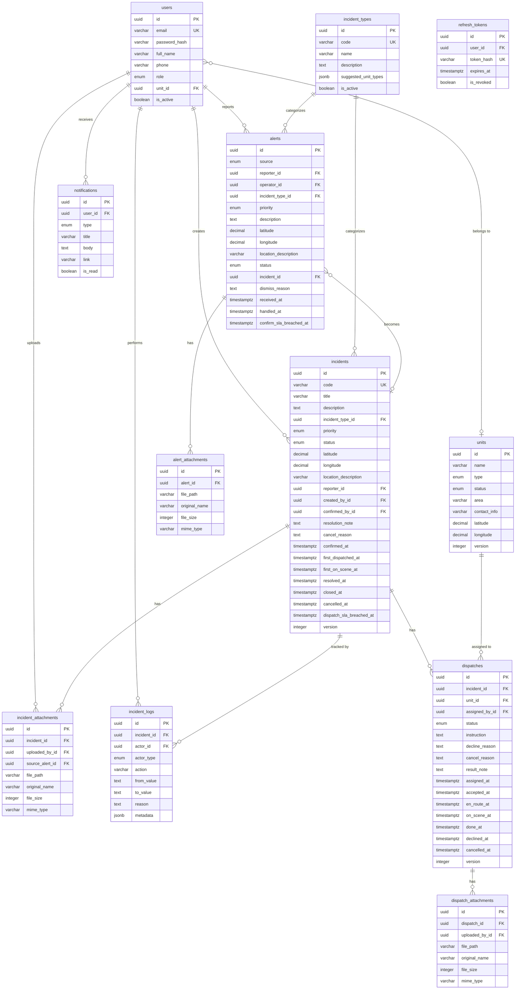

# Thiết kế cơ sở dữ liệu

**Đọc file này khi:** tạo entity, viết migration, viết truy vấn, hoặc cần biết bảng nào chứa dữ liệu gì.

**Nguồn yêu cầu:** [`overview.md`](../00-requirements/overview.md) mục 4–7, [`roles-permissions.md`](../00-requirements/roles-permissions.md), [`user-stories.md`](../00-requirements/user-stories.md), [`incident-state-machine.md`](../02-architecture/incident-state-machine.md), [`realtime-events.md`](../02-architecture/realtime-events.md).

**Liên quan:** [`folder-structure.md`](../02-architecture/folder-structure.md) mục 3 (module → bảng), [`api-contract.md`](../04-api/api-contract.md).

---

## 1. Quy ước chung

| Hạng mục | Quy ước |
|----------|---------|
| Tên bảng | `snake_case`, số nhiều (`incidents`, `dispatches`) |
| Tên cột | `snake_case` |
| Khóa chính | `id` kiểu `UUID`, sinh bằng `uuid_generate_v4()` |
| Thời gian | `TIMESTAMPTZ`, lưu UTC (NFR-10) |
| Xóa mềm | Cột `deleted_at TIMESTAMPTZ NULL`; truy vấn mặc định lọc `deleted_at IS NULL` (BR-03) |
| Khóa lạc quan | Cột `version INTEGER DEFAULT 1`, TypeORM `@VersionColumn()` — dùng trên `incidents`, `dispatches`, `units` |
| Cột chung | Mọi bảng có `id`, `created_at`; hầu hết có `updated_at`; bảng nghiệp vụ chính thêm `deleted_at` và `version` |
| Enum | Lưu kiểu `VARCHAR` với `CHECK` constraint (TypeORM `enum` trên PostgreSQL) |
| JSON | Dùng `JSONB` cho dữ liệu có cấu trúc không cần truy vấn thường xuyên |
| Quan hệ | Khóa ngoại (`REFERENCES`) đặt `ON DELETE RESTRICT` trừ khi ghi rõ khác |
| Độ dài mặc định | `VARCHAR(255)` cho tên, email; `TEXT` cho mô tả, lý do, ghi chú |
| Extension | `uuid-ossp` (sinh UUID) — tạo trong migration đầu tiên |

---

## 2. Sơ đồ quan hệ (ERD)



---

## 3. Chi tiết từng bảng

### 3.1 `users`

Tài khoản người dùng. Mỗi người có đúng một vai trò (FR-AUTH-03). RESPONDER thuộc đúng một lực lượng (FR-UNIT-05).

| Cột | Kiểu | Null | Mặc định | Ghi chú |
|-----|------|------|----------|---------|
| `id` | `UUID` | — | `uuid_generate_v4()` | PK |
| `email` | `VARCHAR(255)` | — | | UK, dùng để đăng nhập |
| `password_hash` | `VARCHAR(255)` | — | | Băm bcrypt (NFR-01) |
| `full_name` | `VARCHAR(255)` | — | | Tên hiển thị |
| `phone` | `VARCHAR(20)` | ✓ | | Thông tin liên hệ, chỉ OPERATOR/COMMANDER xem (BR-09) |
| `role` | `VARCHAR(20)` | — | `'REPORTER'` | Enum: `REPORTER`, `OPERATOR`, `RESPONDER`, `COMMANDER`, `ADMIN` |
| `unit_id` | `UUID` | ✓ | | FK → `units.id`; bắt buộc khi `role = 'RESPONDER'`, `NULL` cho vai trò khác |
| `is_active` | `BOOLEAN` | — | `true` | `false` = tài khoản bị khóa (FR-ADMIN-01) |
| `created_at` | `TIMESTAMPTZ` | — | `NOW()` | |
| `updated_at` | `TIMESTAMPTZ` | — | `NOW()` | |
| `deleted_at` | `TIMESTAMPTZ` | ✓ | | Xóa mềm |

**Ràng buộc:**
- `UQ_users_email`: `UNIQUE (email)` chỉ khi `deleted_at IS NULL`
- `CHK_users_role`: `role IN ('REPORTER','OPERATOR','RESPONDER','COMMANDER','ADMIN')`
- `CHK_users_responder_unit`: nếu `role = 'RESPONDER'` thì `unit_id IS NOT NULL` — kiểm tra ở application layer vì TypeORM không hỗ trợ conditional check tốt

---

### 3.2 `refresh_tokens`

Lưu refresh token để hỗ trợ đăng xuất và thu hồi phiên (FR-AUTH-02). Mỗi lần làm mới tạo bản ghi mới, thu hồi bản cũ.

| Cột | Kiểu | Null | Mặc định | Ghi chú |
|-----|------|------|----------|---------|
| `id` | `UUID` | — | `uuid_generate_v4()` | PK |
| `user_id` | `UUID` | — | | FK → `users.id` |
| `token_hash` | `VARCHAR(255)` | — | | Hash SHA-256 của refresh token |
| `expires_at` | `TIMESTAMPTZ` | — | | Thời điểm hết hạn |
| `is_revoked` | `BOOLEAN` | — | `false` | Đã bị thu hồi (logout, làm mới) |
| `created_at` | `TIMESTAMPTZ` | — | `NOW()` | |

**Ràng buộc:**
- `UQ_refresh_tokens_hash`: `UNIQUE (token_hash)`

---

### 3.3 `incident_types`

Danh mục loại sự cố (FR-ADMIN-02). ADMIN quản lý; mặc định có 5 loại ở [`overview.md`](../00-requirements/overview.md) mục 5.1.

| Cột | Kiểu | Null | Mặc định | Ghi chú |
|-----|------|------|----------|---------|
| `id` | `UUID` | — | `uuid_generate_v4()` | PK |
| `code` | `VARCHAR(50)` | — | | UK. Ví dụ `SECURITY`, `FIRE`, `MEDICAL`, `INFRASTRUCTURE`, `OTHER` |
| `name` | `VARCHAR(100)` | — | | Tên hiển thị tiếng Việt, ví dụ "An ninh trật tự" |
| `description` | `TEXT` | ✓ | | Mô tả, ví dụ |
| `suggested_unit_types` | `JSONB` | — | `'[]'` | Mảng loại lực lượng gợi ý, ví dụ `["SECURITY"]` hoặc `["FIRE_FIGHTING","SECURITY","MEDICAL"]` |
| `is_active` | `BOOLEAN` | — | `true` | `false` = ẩn khỏi danh sách chọn, không xóa |
| `display_order` | `INTEGER` | — | `0` | Thứ tự hiển thị |
| `created_at` | `TIMESTAMPTZ` | — | `NOW()` | |
| `updated_at` | `TIMESTAMPTZ` | — | `NOW()` | |

**Ràng buộc:**
- `UQ_incident_types_code`: `UNIQUE (code)`

---

### 3.4 `alerts`

Cảnh báo — tín hiệu thô chưa xác minh (mục 4 `overview.md`). Ba nguồn: người báo cáo, Operator nhập tay, nguồn tự động.

| Cột | Kiểu | Null | Mặc định | Ghi chú |
|-----|------|------|----------|---------|
| `id` | `UUID` | — | `uuid_generate_v4()` | PK |
| `source` | `VARCHAR(20)` | — | | Enum: `REPORTER`, `OPERATOR`, `AUTOMATED` (FR-ALERT-04) |
| `reporter_id` | `UUID` | ✓ | | FK → `users.id`; người gửi báo cáo (khi `source = 'REPORTER'` hoặc `'OPERATOR'`) |
| `operator_id` | `UUID` | ✓ | | FK → `users.id`; Operator nhập tay (khi `source = 'OPERATOR'`) |
| `incident_type_id` | `UUID` | ✓ | | FK → `incident_types.id`; có thể chưa có (BR-13), hoặc là đề xuất từ nguồn tự động (BR-14) |
| `priority` | `VARCHAR(20)` | ✓ | | Enum: `CRITICAL`, `HIGH`, `MEDIUM`, `LOW`; `NULL` = chưa phân loại (BR-13) |
| `description` | `TEXT` | — | | Mô tả cảnh báo |
| `latitude` | `DECIMAL(10,7)` | — | | Vĩ độ |
| `longitude` | `DECIMAL(10,7)` | — | | Kinh độ |
| `location_description` | `VARCHAR(500)` | ✓ | | Mô tả vị trí bằng lời |
| `status` | `VARCHAR(20)` | — | `'NEW'` | Enum: `NEW`, `CONFIRMED`, `DISMISSED`, `MERGED` |
| `incident_id` | `UUID` | ✓ | | FK → `incidents.id`; gán khi `CONFIRMED` hoặc `MERGED` (TR-AL-01, TR-AL-03) |
| `dismiss_reason` | `TEXT` | ✓ | | Lý do loại bỏ; bắt buộc khi `DISMISSED` (BR-02) |
| `received_at` | `TIMESTAMPTZ` | — | `NOW()` | Thời điểm nhận; bắt đầu đồng hồ SLA xác nhận |
| `handled_at` | `TIMESTAMPTZ` | ✓ | | Thời điểm rời `NEW` (xác nhận, loại bỏ hoặc gộp) |
| `confirm_sla_breached_at` | `TIMESTAMPTZ` | ✓ | | Cờ vi phạm SLA xác nhận; chỉ đặt một lần |
| `created_at` | `TIMESTAMPTZ` | — | `NOW()` | |
| `updated_at` | `TIMESTAMPTZ` | — | `NOW()` | |
| `deleted_at` | `TIMESTAMPTZ` | ✓ | | Xóa mềm |

**Ràng buộc:**
- `CHK_alerts_source`: `source IN ('REPORTER','OPERATOR','AUTOMATED')`
- `CHK_alerts_status`: `status IN ('NEW','CONFIRMED','DISMISSED','MERGED')`
- `CHK_alerts_priority`: `priority IS NULL OR priority IN ('CRITICAL','HIGH','MEDIUM','LOW')`
- `CHK_alerts_dismiss_reason`: `status != 'DISMISSED' OR dismiss_reason IS NOT NULL` — kiểm tra ở application layer

---

### 3.5 `alert_attachments`

Ảnh đính kèm khi gửi báo cáo (FR-ALERT-01, BR-10: tối đa 5 ảnh, mỗi ảnh ≤ 5 MB).

| Cột | Kiểu | Null | Mặc định | Ghi chú |
|-----|------|------|----------|---------|
| `id` | `UUID` | — | `uuid_generate_v4()` | PK |
| `alert_id` | `UUID` | — | | FK → `alerts.id` |
| `file_path` | `VARCHAR(500)` | — | | Đường dẫn file trên server |
| `original_name` | `VARCHAR(255)` | — | | Tên file gốc |
| `file_size` | `INTEGER` | — | | Dung lượng (bytes) |
| `mime_type` | `VARCHAR(100)` | — | | Kiểu MIME, ví dụ `image/jpeg` |
| `created_at` | `TIMESTAMPTZ` | — | `NOW()` | |

**Ràng buộc:**
- `CHK_alert_attachments_size`: `file_size > 0 AND file_size <= 5242880` (5 MB)
- Giới hạn tối đa 5 ảnh mỗi cảnh báo: kiểm tra ở application layer

---

### 3.6 `incidents`

Sự cố — cảnh báo đã xác minh hoặc được tạo trực tiếp. Bảng trung tâm của hệ thống.

| Cột | Kiểu | Null | Mặc định | Ghi chú |
|-----|------|------|----------|---------|
| `id` | `UUID` | — | `uuid_generate_v4()` | PK |
| `code` | `VARCHAR(30)` | — | | UK. Mã hiển thị duy nhất, ví dụ `INC-20261124-0001` (BR-01) |
| `title` | `VARCHAR(255)` | — | | Tiêu đề ngắn gọn |
| `description` | `TEXT` | ✓ | | Mô tả chi tiết |
| `incident_type_id` | `UUID` | — | | FK → `incident_types.id` |
| `priority` | `VARCHAR(20)` | — | | Enum: `CRITICAL`, `HIGH`, `MEDIUM`, `LOW` |
| `status` | `VARCHAR(20)` | — | `'NEW'` | Enum: `NEW`, `CONFIRMED`, `DISPATCHED`, `IN_PROGRESS`, `RESOLVED`, `CLOSED`, `CANCELLED` |
| `latitude` | `DECIMAL(10,7)` | — | | Vĩ độ |
| `longitude` | `DECIMAL(10,7)` | — | | Kinh độ |
| `location_description` | `VARCHAR(500)` | ✓ | | Mô tả vị trí bằng lời |
| `reporter_id` | `UUID` | ✓ | | FK → `users.id`; người báo cáo gốc (nếu tạo từ cảnh báo của REPORTER) |
| `created_by_id` | `UUID` | — | | FK → `users.id`; Operator/Commander tạo sự cố |
| `confirmed_by_id` | `UUID` | ✓ | | FK → `users.id`; người xác nhận; `NULL` nếu tạo từ cảnh báo (đã xác nhận khi tạo) |
| `resolution_note` | `TEXT` | ✓ | | Kết quả xử lý; bắt buộc khi đóng sự cố (TR-IN-07) |
| `cancel_reason` | `TEXT` | ✓ | | Lý do hủy; bắt buộc khi hủy (BR-02) |
| `confirmed_at` | `TIMESTAMPTZ` | ✓ | | Mốc xác nhận; bắt đầu đồng hồ SLA điều phối |
| `first_dispatched_at` | `TIMESTAMPTZ` | ✓ | | Mốc điều phối đầu tiên; kết thúc SLA điều phối |
| `first_on_scene_at` | `TIMESTAMPTZ` | ✓ | | Mốc lực lượng đầu tiên đến hiện trường |
| `resolved_at` | `TIMESTAMPTZ` | ✓ | | Mốc giải quyết; xóa khi mở lại (TR-IN-09) |
| `closed_at` | `TIMESTAMPTZ` | ✓ | | Mốc đóng; xóa khi mở lại (TR-IN-09) |
| `cancelled_at` | `TIMESTAMPTZ` | ✓ | | Mốc hủy |
| `dispatch_sla_breached_at` | `TIMESTAMPTZ` | ✓ | | Cờ vi phạm SLA điều phối; chỉ đặt một lần |
| `version` | `INTEGER` | — | `1` | Khóa lạc quan (optimistic locking) |
| `created_at` | `TIMESTAMPTZ` | — | `NOW()` | Nếu tạo trực tiếp, dùng làm `receivedAt` cho thống kê |
| `updated_at` | `TIMESTAMPTZ` | — | `NOW()` | |
| `deleted_at` | `TIMESTAMPTZ` | ✓ | | Xóa mềm |

**Ràng buộc:**
- `UQ_incidents_code`: `UNIQUE (code)`
- `CHK_incidents_priority`: `priority IN ('CRITICAL','HIGH','MEDIUM','LOW')`
- `CHK_incidents_status`: `status IN ('NEW','CONFIRMED','DISPATCHED','IN_PROGRESS','RESOLVED','CLOSED','CANCELLED')`

**Quy tắc sinh mã hiển thị (BR-01):**

Định dạng: `INC-YYYYMMDD-NNNN` trong đó `NNNN` là số thứ tự trong ngày, đệm 0.

Cách sinh: dùng sequence hoặc đếm trong ngày. Gợi ý dùng hàm `generateIncidentCode()` trong `common/utils/code-generator.util.ts`, chạy trong transaction để đảm bảo duy nhất.

---

### 3.7 `incident_attachments`

Ảnh đính kèm sự cố (FR-INC-05). Bao gồm ảnh chuyển từ cảnh báo khi xác nhận, và ảnh thêm bởi Operator.

| Cột | Kiểu | Null | Mặc định | Ghi chú |
|-----|------|------|----------|---------|
| `id` | `UUID` | — | `uuid_generate_v4()` | PK |
| `incident_id` | `UUID` | — | | FK → `incidents.id` |
| `uploaded_by_id` | `UUID` | — | | FK → `users.id` |
| `source_alert_id` | `UUID` | ✓ | | FK → `alerts.id`; `NOT NULL` nếu ảnh chuyển từ cảnh báo |
| `file_path` | `VARCHAR(500)` | — | | Đường dẫn file trên server |
| `original_name` | `VARCHAR(255)` | — | | Tên file gốc |
| `file_size` | `INTEGER` | — | | Dung lượng (bytes) |
| `mime_type` | `VARCHAR(100)` | — | | Kiểu MIME |
| `created_at` | `TIMESTAMPTZ` | — | `NOW()` | |

---

### 3.8 `units`

Lực lượng xử lý (FR-UNIT-01 đến FR-UNIT-05).

| Cột | Kiểu | Null | Mặc định | Ghi chú |
|-----|------|------|----------|---------|
| `id` | `UUID` | — | `uuid_generate_v4()` | PK |
| `name` | `VARCHAR(255)` | — | | Tên lực lượng, ví dụ "Tổ bảo vệ A" |
| `type` | `VARCHAR(20)` | — | | Enum: `SECURITY`, `FIRE_FIGHTING`, `MEDICAL`, `TECHNICAL` |
| `status` | `VARCHAR(20)` | — | `'OFFLINE'` | Enum: `AVAILABLE`, `BUSY`, `OFFLINE` |
| `area` | `VARCHAR(255)` | ✓ | | Khu vực phụ trách |
| `contact_info` | `VARCHAR(255)` | ✓ | | Thông tin liên hệ (số điện thoại, bộ đàm) |
| `latitude` | `DECIMAL(10,7)` | ✓ | | Vĩ độ hiện tại; cập nhật thủ công (A-08) |
| `longitude` | `DECIMAL(10,7)` | ✓ | | Kinh độ hiện tại |
| `version` | `INTEGER` | — | `1` | Khóa lạc quan |
| `created_at` | `TIMESTAMPTZ` | — | `NOW()` | |
| `updated_at` | `TIMESTAMPTZ` | — | `NOW()` | |
| `deleted_at` | `TIMESTAMPTZ` | ✓ | | Xóa mềm |

**Ràng buộc:**
- `CHK_units_type`: `type IN ('SECURITY','FIRE_FIGHTING','MEDICAL','TECHNICAL')`
- `CHK_units_status`: `status IN ('AVAILABLE','BUSY','OFFLINE')`

---

### 3.9 `dispatches`

Lệnh điều phối — giao lực lượng xử lý sự cố (FR-DISP-01 đến FR-DISP-10).

| Cột | Kiểu | Null | Mặc định | Ghi chú |
|-----|------|------|----------|---------|
| `id` | `UUID` | — | `uuid_generate_v4()` | PK |
| `incident_id` | `UUID` | — | | FK → `incidents.id` |
| `unit_id` | `UUID` | — | | FK → `units.id` |
| `assigned_by_id` | `UUID` | — | | FK → `users.id`; Operator/Commander đã giao lệnh |
| `status` | `VARCHAR(20)` | — | `'ASSIGNED'` | Enum: `ASSIGNED`, `ACCEPTED`, `EN_ROUTE`, `ON_SCENE`, `DONE`, `DECLINED`, `CANCELLED` |
| `instruction` | `TEXT` | ✓ | | Chỉ dẫn của Operator khi giao lệnh |
| `decline_reason` | `TEXT` | ✓ | | Lý do từ chối; bắt buộc khi `DECLINED` (BR-02) |
| `cancel_reason` | `TEXT` | ✓ | | Lý do thu hồi/hủy; bắt buộc khi `CANCELLED` (BR-02) |
| `result_note` | `TEXT` | ✓ | | Ghi chú kết quả xử lý khi `DONE` |
| `assigned_at` | `TIMESTAMPTZ` | — | `NOW()` | Thời điểm giao lệnh |
| `accepted_at` | `TIMESTAMPTZ` | ✓ | | Thời điểm chấp nhận |
| `en_route_at` | `TIMESTAMPTZ` | ✓ | | Thời điểm bắt đầu di chuyển |
| `on_scene_at` | `TIMESTAMPTZ` | ✓ | | Thời điểm đến hiện trường |
| `done_at` | `TIMESTAMPTZ` | ✓ | | Thời điểm hoàn thành |
| `declined_at` | `TIMESTAMPTZ` | ✓ | | Thời điểm từ chối |
| `cancelled_at` | `TIMESTAMPTZ` | ✓ | | Thời điểm bị thu hồi |
| `version` | `INTEGER` | — | `1` | Khóa lạc quan |
| `created_at` | `TIMESTAMPTZ` | — | `NOW()` | |
| `updated_at` | `TIMESTAMPTZ` | — | `NOW()` | |
| `deleted_at` | `TIMESTAMPTZ` | ✓ | | Xóa mềm |

**Ràng buộc:**
- `CHK_dispatches_status`: `status IN ('ASSIGNED','ACCEPTED','EN_ROUTE','ON_SCENE','DONE','DECLINED','CANCELLED')`

**Quy tắc nghiệp vụ kiểm tra ở application layer:**
- Một lực lượng không có hai lệnh hoạt động cùng lúc (mục 3 `incident-state-machine.md`)
- Lệnh chỉ được từ chối ở `ASSIGNED`
- Các bước tuần tự: `ACCEPTED` → `EN_ROUTE` → `ON_SCENE` → `DONE`, không nhảy cóc

---

### 3.10 `dispatch_attachments`

Ảnh hiện trường do lực lượng đính kèm (FR-DISP-09).

| Cột | Kiểu | Null | Mặc định | Ghi chú |
|-----|------|------|----------|---------|
| `id` | `UUID` | — | `uuid_generate_v4()` | PK |
| `dispatch_id` | `UUID` | — | | FK → `dispatches.id` |
| `uploaded_by_id` | `UUID` | — | | FK → `users.id`; RESPONDER tải lên |
| `file_path` | `VARCHAR(500)` | — | | Đường dẫn file trên server |
| `original_name` | `VARCHAR(255)` | — | | Tên file gốc |
| `file_size` | `INTEGER` | — | | Dung lượng (bytes) |
| `mime_type` | `VARCHAR(100)` | — | | Kiểu MIME |
| `created_at` | `TIMESTAMPTZ` | — | `NOW()` | |

**Ràng buộc:**
- `CHK_dispatch_attachments_size`: `file_size > 0 AND file_size <= 5242880` (5 MB)

---

### 3.11 `incident_logs`

Nhật ký bất biến — ghi lại mọi thao tác trên sự cố (FR-LOG-01 đến FR-LOG-03). **Không có cột `updated_at`, `deleted_at`** — không thể sửa/xóa (BR-03, NFR-04).

| Cột | Kiểu | Null | Mặc định | Ghi chú |
|-----|------|------|----------|---------|
| `id` | `UUID` | — | `uuid_generate_v4()` | PK |
| `incident_id` | `UUID` | — | | FK → `incidents.id` |
| `actor_id` | `UUID` | ✓ | | FK → `users.id`; `NULL` khi `actor_type = 'SYSTEM'` |
| `actor_type` | `VARCHAR(10)` | — | | Enum: `USER`, `SYSTEM` |
| `action` | `VARCHAR(50)` | — | | Loại hành động (xem bảng bên dưới) |
| `from_value` | `TEXT` | ✓ | | Giá trị cũ (trạng thái hoặc giá trị trường) |
| `to_value` | `TEXT` | ✓ | | Giá trị mới |
| `reason` | `TEXT` | ✓ | | Lý do (khi BR-02 yêu cầu) |
| `metadata` | `JSONB` | ✓ | | Dữ liệu bổ sung: `dispatchId`, `unitId`, `alertId`... |
| `created_at` | `TIMESTAMPTZ` | — | `NOW()` | Thời điểm hành động |

**Các giá trị `action`:**

| Action | Khi nào |
|--------|---------|
| `STATUS_CHANGED` | Sự cố đổi trạng thái (thủ công hoặc tự động) |
| `FIELD_UPDATED` | Sửa loại, mức ưu tiên, vị trí, mô tả (FR-INC-03) |
| `PRIORITY_CHANGED` | Đổi mức ưu tiên (BR-12, ghi riêng vì cần lý do) |
| `DISPATCH_CREATED` | Tạo lệnh điều phối |
| `DISPATCH_STATUS_CHANGED` | Lệnh đổi trạng thái |
| `ALERT_CONFIRMED` | Cảnh báo được xác nhận thành sự cố |
| `ALERT_MERGED` | Cảnh báo được gộp vào sự cố |
| `ATTACHMENT_ADDED` | Thêm ảnh đính kèm |
| `REOPENED` | Mở lại sự cố (TR-IN-09) |

**Ví dụ `metadata`:**

```json
// DISPATCH_CREATED
{ "dispatchId": "...", "unitId": "...", "unitName": "Tổ bảo vệ A" }

// DISPATCH_STATUS_CHANGED
{ "dispatchId": "...", "unitId": "...", "unitName": "Tổ bảo vệ A" }

// ALERT_CONFIRMED
{ "alertId": "..." }

// FIELD_UPDATED
{ "field": "priority" }
```

---

### 3.12 `notifications`

Thông báo cá nhân (FR-NOTI-01 đến FR-NOTI-03). Lưu vào DB trước, rồi đẩy socket.

| Cột | Kiểu | Null | Mặc định | Ghi chú |
|-----|------|------|----------|---------|
| `id` | `UUID` | — | `uuid_generate_v4()` | PK |
| `user_id` | `UUID` | — | | FK → `users.id`; người nhận |
| `type` | `VARCHAR(30)` | — | | Enum loại thông báo (xem bảng bên dưới) |
| `title` | `VARCHAR(255)` | — | | Tiêu đề hiển thị |
| `body` | `TEXT` | ✓ | | Nội dung chi tiết |
| `link` | `VARCHAR(255)` | ✓ | | Đường dẫn trong ứng dụng, ví dụ `/incidents/{id}` |
| `is_read` | `BOOLEAN` | — | `false` | Đã đọc |
| `created_at` | `TIMESTAMPTZ` | — | `NOW()` | |

**Các giá trị `type`** (từ [`realtime-events.md`](../02-architecture/realtime-events.md) mục 5.3):

| Type | Khi nào | Người nhận |
|------|---------|-----------|
| `ALERT_HIGH_PRIORITY` | Cảnh báo `CRITICAL`/`HIGH` mới | Mọi OPERATOR |
| `DISPATCH_ASSIGNED` | Lệnh điều phối mới | RESPONDER của lực lượng |
| `DISPATCH_DECLINED` | Lực lượng từ chối | Mọi OPERATOR |
| `DISPATCH_CANCELLED` | Lệnh bị thu hồi hoặc sự cố bị hủy | RESPONDER của lực lượng |
| `INCIDENT_RESOLVED` | Sự cố → `RESOLVED` | Mọi OPERATOR |
| `REPORT_UPDATED` | Sự cố đóng, cảnh báo bị loại bỏ/gộp | Người báo cáo |
| `SLA_BREACHED` | Quá hạn SLA | Mọi OPERATOR, COMMANDER |

---

## 4. Chỉ mục (Index)

Ngoài các chỉ mục mặc định trên PK và UK, tạo thêm:

### 4.1 Chỉ mục cho truy vấn thường xuyên

| Bảng | Chỉ mục | Cột | Lý do |
|------|---------|-----|-------|
| `alerts` | `IDX_alerts_status_received` | `(status, received_at)` | Hàng đợi cảnh báo mới, sắp theo thời gian (FR-ALERT-05) |
| `alerts` | `IDX_alerts_reporter` | `(reporter_id)` | REPORTER xem báo cáo của mình |
| `alerts` | `IDX_alerts_sla` | `(status, confirm_sla_breached_at)` | Tác vụ kiểm tra SLA (tìm cảnh báo `NEW` chưa vi phạm) |
| `incidents` | `IDX_incidents_status` | `(status)` | Lọc theo trạng thái |
| `incidents` | `IDX_incidents_priority_status` | `(priority, status)` | Dashboard: sự cố đang mở theo mức ưu tiên |
| `incidents` | `IDX_incidents_created_at` | `(created_at DESC)` | Danh sách phân trang mặc định |
| `incidents` | `IDX_incidents_reporter` | `(reporter_id)` | REPORTER xem sự cố của mình |
| `incidents` | `IDX_incidents_type` | `(incident_type_id)` | Lọc và thống kê theo loại |
| `incidents` | `IDX_incidents_sla` | `(status, dispatch_sla_breached_at)` | Tác vụ kiểm tra SLA |
| `dispatches` | `IDX_dispatches_incident` | `(incident_id)` | Lấy tất cả lệnh của một sự cố |
| `dispatches` | `IDX_dispatches_unit_status` | `(unit_id, status)` | Kiểm tra lực lượng có lệnh hoạt động không |
| `dispatches` | `IDX_dispatches_status` | `(status)` | Lọc lệnh theo trạng thái |
| `units` | `IDX_units_type_status` | `(type, status)` | Gợi ý lực lượng: đúng loại + `AVAILABLE` (FR-DISP-01) |
| `incident_logs` | `IDX_incident_logs_incident_created` | `(incident_id, created_at)` | Timeline của sự cố (FR-LOG-03) |
| `notifications` | `IDX_notifications_user_read` | `(user_id, is_read, created_at DESC)` | Danh sách thông báo chưa đọc, mới nhất trước |
| `refresh_tokens` | `IDX_refresh_tokens_user` | `(user_id)` | Tìm token của người dùng khi đăng xuất tất cả |

### 4.2 Partial index (chỉ mục có điều kiện)

| Bảng | Chỉ mục | Điều kiện | Lý do |
|------|---------|-----------|-------|
| `alerts` | `IDX_alerts_new_location` | `WHERE status = 'NEW'` trên `(incident_type_id, latitude, longitude, received_at)` | Gợi ý trùng lặp: cảnh báo cùng loại, ≤ 100 m, ≤ 10 phút (FR-ALERT-07) |
| `dispatches` | `IDX_dispatches_active_unit` | `WHERE status IN ('ASSIGNED','ACCEPTED','EN_ROUTE','ON_SCENE')` trên `(unit_id)` | Kiểm tra nhanh lực lượng có lệnh hoạt động không |
| `notifications` | `IDX_notifications_unread` | `WHERE is_read = false` trên `(user_id, created_at DESC)` | Đếm số chưa đọc |

---

## 5. Gợi ý trùng lặp cảnh báo (FR-ALERT-07)

Truy vấn gợi ý trùng lặp khi nhận cảnh báo mới:

```sql
-- Tìm sự cố đang mở gần vị trí và thời gian
-- Khoảng cách Haversine tính ở application layer (geo.util.ts)
-- Truy vấn chỉ lọc sơ bộ bằng bounding box rồi tính chính xác trong code

SELECT i.id, i.code, i.title, i.latitude, i.longitude
FROM incidents i
WHERE i.status IN ('NEW', 'CONFIRMED', 'DISPATCHED', 'IN_PROGRESS')
  AND i.incident_type_id = :typeId
  AND i.deleted_at IS NULL
  AND i.created_at >= NOW() - INTERVAL '10 minutes'
  AND i.latitude BETWEEN :lat - 0.0009 AND :lat + 0.0009   -- ~100m
  AND i.longitude BETWEEN :lng - 0.0012 AND :lng + 0.0012  -- ~100m tại VN
ORDER BY i.created_at DESC;
```

Khoảng cách chính xác tính bằng Haversine trong `common/utils/geo.util.ts` (xem `folder-structure.md`), chỉ dùng đường chim bay (BR-11).

---

## 6. Dữ liệu mẫu (Seed — FR-ADMIN-04)

### 6.1 Loại sự cố

| `code` | `name` | `suggested_unit_types` |
|--------|--------|----------------------|
| `SECURITY` | An ninh trật tự | `["SECURITY"]` |
| `FIRE` | Cháy nổ (PCCC) | `["FIRE_FIGHTING","SECURITY","MEDICAL"]` |
| `MEDICAL` | Y tế khẩn cấp | `["MEDICAL","SECURITY"]` |
| `INFRASTRUCTURE` | Sự cố kỹ thuật/hạ tầng | `["TECHNICAL","SECURITY"]` |
| `OTHER` | Khác | `[]` |

### 6.2 Tài khoản mẫu

| Email | Vai trò | Mật khẩu | Lực lượng |
|-------|---------|-----------|-----------|
| `admin@safeops.local` | ADMIN | `Admin@123` | — |
| `commander@safeops.local` | COMMANDER | `Commander@123` | — |
| `operator1@safeops.local` | OPERATOR | `Operator@123` | — |
| `operator2@safeops.local` | OPERATOR | `Operator@123` | — |
| `responder.security1@safeops.local` | RESPONDER | `Responder@123` | Tổ bảo vệ A |
| `responder.security2@safeops.local` | RESPONDER | `Responder@123` | Tổ bảo vệ B |
| `responder.fire@safeops.local` | RESPONDER | `Responder@123` | Xe PCCC 1 |
| `responder.medical@safeops.local` | RESPONDER | `Responder@123` | Tổ y tế |
| `responder.tech@safeops.local` | RESPONDER | `Responder@123` | Tổ kỹ thuật |
| `reporter1@safeops.local` | REPORTER | `Reporter@123` | — |
| `reporter2@safeops.local` | REPORTER | `Reporter@123` | — |

### 6.3 Lực lượng mẫu

| Tên | Loại | Trạng thái | Khu vực | Vị trí (lat, lng) |
|-----|------|-----------|---------|-------------------|
| Tổ bảo vệ A | `SECURITY` | `AVAILABLE` | Khu A — Cổng chính | `10.7625, 106.6600` |
| Tổ bảo vệ B | `SECURITY` | `AVAILABLE` | Khu B — Nhà kho | `10.7635, 106.6620` |
| Xe PCCC 1 | `FIRE_FIGHTING` | `AVAILABLE` | Trạm PCCC | `10.7640, 106.6610` |
| Tổ y tế | `MEDICAL` | `AVAILABLE` | Phòng y tế | `10.7630, 106.6605` |
| Tổ kỹ thuật | `TECHNICAL` | `OFFLINE` | Xưởng bảo trì | `10.7620, 106.6615` |

> [!NOTE]
> Tọa độ mẫu nằm trong khu vực TP.HCM. Khi demo, frontend đặt tâm bản đồ theo khoảng tọa độ này.

---

## 7. Migration đầu tiên

Migration đầu tiên (`initial-schema`) nên:

1. Tạo extension `uuid-ossp`.
2. Tạo toàn bộ bảng theo thứ tự phụ thuộc:
   - `incident_types` (không phụ thuộc)
   - `units` (không phụ thuộc)
   - `users` (phụ thuộc `units`)
   - `refresh_tokens` (phụ thuộc `users`)
   - `incidents` (phụ thuộc `incident_types`, `users`)
   - `alerts` (phụ thuộc `incident_types`, `users`, `incidents`)
   - `alert_attachments` (phụ thuộc `alerts`)
   - `incident_attachments` (phụ thuộc `incidents`, `users`, `alerts`)
   - `dispatches` (phụ thuộc `incidents`, `units`, `users`)
   - `dispatch_attachments` (phụ thuộc `dispatches`, `users`)
   - `incident_logs` (phụ thuộc `incidents`, `users`)
   - `notifications` (phụ thuộc `users`)
3. Tạo tất cả chỉ mục ở mục 4.

```bash
# Sinh migration (chạy trong container hoặc local)
pnpm migration:generate -- initial-schema

# Chạy migration
pnpm migration:run

# Nạp dữ liệu mẫu
pnpm seed
```

---

## 8. Điểm cần nhóm xác nhận

| # | Nội dung | Mặc định đang dùng |
|---|---------|-------------------|
| 1 | Tách 3 bảng attachment (`alert_`, `incident_`, `dispatch_`) hay dùng một bảng chung với `entity_type` + `entity_id`? | Tách riêng (rõ ràng, dễ validate, dễ quan hệ) |
| 2 | `incidents.confirmed_by_id` có cần không, hay lấy từ `incident_logs`? | Giữ — truy vấn nhanh hơn khi hiển thị |
| 3 | Giới hạn ảnh 5 cái mỗi cảnh báo (BR-10): áp dụng tương tự cho sự cố và lệnh? | Có, cùng giới hạn 5 ảnh — kiểm tra ở app layer |
| 4 | Tọa độ seed data dùng khu vực nào? | TP.HCM (`10.76x, 106.66x`) |
| 5 | Mật khẩu seed account dùng pattern nào? | `{Role}@123` — chỉ dùng cho dev, không commit `.env` |

---

## 9. Lịch sử thay đổi

| Phiên bản | Ngày | Nội dung | Người thực hiện |
|-----------|------|---------|-----------------|
| 0.1 | 2026-11-24 | Bản nháp đầu tiên — đầy đủ 12 bảng, index, seed data | Nhóm G1.1 |
