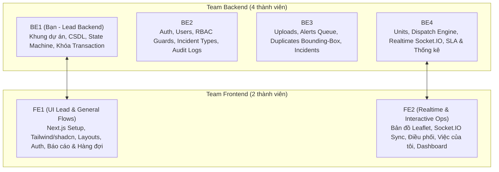
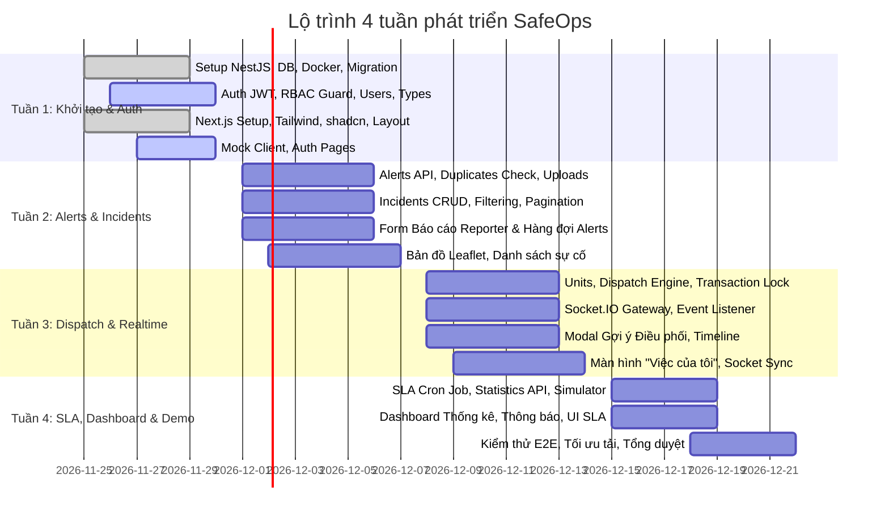

# Kế hoạch Thực thi Dự án SafeOps (4 Tuần / 1 Tháng)

**Dự án:** SafeOps — Hệ thống Quản lý và Điều phối Sự cố An ninh theo Thời gian thực (Đề tài G1.1)  
**Thời gian thực hiện:** 4 tuần (1 tháng)  
**Quy mô nhân sự:** 6 thành viên (4 Backend, 2 Frontend)  
**Tham chiếu kỹ thuật:** [`docs/01-srs/srs.md`](../01-srs/srs.md), [`docs/02-architecture/`](../02-architecture/), [`docs/03-database/erd.md`](../03-database/erd.md), [`docs/04-api/api-contract.md`](../04-api/api-contract.md), [`.agent/rules/`](../../.agent/rules/).

---

## 1. Cơ cấu Đội ngũ & Phân công Trách nhiệm (Team Structure)

### Bảng phân vai chi tiết:

| Thành viên | Trách nhiệm chính | Module phụ trách chính |
|---|---|---|
| **BE1 (Bạn - Lead)** | Kiến trúc tổng thể, Base Entity, Migration đầu tiên, Engine máy trạng thái, Quản lý giao dịch & Khóa bi quan, Code review. | `database/`, `common/state-machine/`, `incidents/derive-incident-status.ts` |
| **BE2** | Quản lý người dùng, Xác thực JWT kép, Phân quyền RBAC, Danh mục loại sự cố, Ghi nhật ký bất biến. | `modules/auth/`, `modules/users/`, `modules/incident-types/`, `modules/incident-logs/` |
| **BE3** | Xử lý tệp đính kèm, Tiếp nhận cảnh báo, Giải thuật gợi ý trùng lặp, Nghiệp vụ sự cố cơ bản. | `modules/uploads/`, `modules/alerts/`, `modules/incidents/` |
| **BE4** | Quản lý lực lượng, Cự ly Haversine, Động cơ điều phối, Gateway Socket.IO, Tác vụ nền SLA & Thống kê. | `modules/units/`, `modules/dispatch/`, `modules/realtime/`, `modules/sla/`, `modules/statistics/` |
| **FE1** | Khung Next.js, Styling shadcn/ui + Tailwind CSS, Layout phân quyền, Xác thực, Form báo cáo Reporter, Hàng đợi Operator, Quản trị Admin. | `features/auth/`, `features/reports/`, `features/alerts/`, `components/layout/`, `app/(auth)/` |
| **FE2** | Tích hợp bản đồ Leaflet, Quản lý WebSocket Socket.IO, Đồng bộ cache TanStack Query, Màn hình điều phối SOC, Màn hình Responder, Dashboard. | `features/map/`, `features/incidents/`, `features/dispatch/`, `features/my-tasks/`, `features/statistics/`, `providers/SocketProvider` |

---

## 2. Lộ trình Tổng quan 4 Tuần (Master Roadmap)

---

## 3. Kế hoạch Chi tiết Từng Tuần (Weekly Breakdown)

### TUẦN 1: Khởi tạo Khung dự án, Cơ sở Dữ liệu & Phân hệ Xác thực
> **Mục tiêu tuần 1:** Dựng hoàn chỉnh bộ khung cả Backend và Frontend, chạy được trên Docker bằng `pnpm`. Hoàn thành phân hệ Đăng nhập/Đăng ký và xác thực vai trò (RBAC).

#### 1. Nhiệm vụ Backend:
- **BE1 (Lead):**
  - Khởi tạo dự án NestJS trong `apps/backend` với `pnpm`. Cấu hình `docker-compose.yml` (PostgreSQL 16 + NestJS dev mode).
  - Viết `BaseAppEntity` (`id UUID`, `created_at`, `updated_at`, `deleted_at`).
  - Viết cấu hình kết nối TypeORM (`database.config.ts`, `data-source.ts`) với quy tắc **`synchronize: false`**.
  - Viết script Migration khởi tạo toàn bộ 12 bảng theo đúng [`erd.md`](../03-database/erd.md).
  - Viết script `seed.ts` nạp dữ liệu mẫu ban đầu: 5 loại sự cố, 5 đội lực lượng, 11 tài khoản kiểm thử.
  - Thiết lập Global Filter `AllExceptionsFilter` và Global Pipe `ValidationPipe`.
- **BE2:**
  - Viết module `auth`: Cấp phát JWT Access Token (15 phút) và Refresh Token (7 ngày). Lưu token hash vào bảng `refresh_tokens`.
  - Endpoint: `POST /api/v1/auth/login`, `POST /api/v1/auth/register` (chỉ cấp vai trò `REPORTER`), `POST /api/v1/auth/refresh`, `POST /api/v1/auth/logout`, `GET /api/v1/auth/me`.
  - Viết `JwtAuthGuard`, `RolesGuard`, decorator `@Roles(...)`, `@CurrentUser()`, `@Public()`.
  - Viết module `users`: Endpoint quản lý tài khoản nội bộ cho ADMIN (`GET /api/v1/users`, `PATCH /api/v1/users/:id/status`, `PATCH /api/v1/users/:id/role`).
  - Viết module `incident-types`: Endpoint lấy danh mục loại sự cố (`GET /api/v1/incident-types`) và quản trị CUD cho ADMIN.
- **BE3 & BE4:**
  - Hỗ trợ viết Unit test cho Auth & Users service.
  - Cấu hình Swagger OpenAPI tại `/api` để Frontend có tài liệu tương tác trực tiếp.

#### 2. Nhiệm vụ Frontend:
- **FE1 (UI Lead):**
  - Khởi tạo dự án Next.js (App Router, TypeScript) trong `apps/frontend` với `pnpm`.
  - Cấu hình Tailwind CSS và tích hợp thư viện component `shadcn/ui` (Button, Input, Card, Table, Dialog, Toast, Form).
  - Xây dựng cấu trúc layout: Layout đăng nhập `(auth)` và Layout chính `(app)` có Sidebar điều hướng thích ứng theo 5 vai trò.
  - Viết trang `/login` và `/register`.
- **FE2:**
  - Thiết lập `providers/QueryProvider.tsx` (TanStack Query) và `providers/AuthProvider.tsx`.
  - Viết `lib/api-client.ts`: Tự động đính kèm `Authorization: Bearer <token>`, tự động gọi `/auth/refresh` khi nhận lỗi 401.
  - Định nghĩa toàn bộ TypeScript Enums & Interfaces trong `src/types/` đồng bộ từ [`api-contract.md`](../04-api/api-contract.md).
  - Viết component `ConnectionBadge` (hiển thị trạng thái kết nối mạng trên Header).

#### 3. Tiêu chí Nghiệm thu Tuần 1 (Milestone 1):
- [x] Chạy `docker compose up` ở cả 2 thư mục thành công không lỗi.
- [x] Chạy `pnpm migration:run` và `pnpm seed` nạp đủ 11 tài khoản mẫu.
- [x] Đăng nhập trên giao diện Web bằng tài khoản bất kỳ trong seed data thành công.
- [x] Chuyển đổi giữa các tài khoản: Sidebar tự động ẩn/hiện menu chính xác theo ma trận phân quyền [`roles-permissions.md`](../00-requirements/roles-permissions.md).

---

### TUẦN 2: Tiếp nhận Cảnh báo, Quản lý Sự cố & Tích hợp Bản đồ Số
> **Mục tiêu tuần 2:** Xây dựng luồng tiếp nhận cảnh báo từ người dân (Reporter), xác minh của điều phối viên (Operator), chuyển hóa thành Sự cố và hiển thị trực quan trên bản đồ Leaflet.

#### 1. Nhiệm vụ Backend:
- **BE1 (Lead):**
  - Hiện thực lõi máy trạng thái Sự cố: `incident-transitions.ts` và hàm suy diễn trạng thái `derive-incident-status.ts`.
  - Viết Unit test 100% độ phủ cho `deriveIncidentStatus` và `findTransition`.
  - Xây dựng module `incidents`: CRUD sự cố, bộ lọc đa tiêu chí (phân trang, loại sự cố, mức ưu tiên, trạng thái, tìm kiếm từ khóa theo mã/tiêu đề).
  - Đảm bảo tính toán mã sự cố tự động theo ngày: `INC-YYYYMMDD-NNNN` (BR-01).
- **BE3:**
  - Xây dựng module `uploads`: Tiếp nhận file `multipart/form-data`, xác thực MIME type ảnh (`jpeg`, `png`, `webp`), dung lượng tối đa 5MB (BR-10), đổi tên file bằng UUID.
  - Xây dựng module `alerts`:
    - `POST /api/v1/alerts`: Người báo cáo hoặc Operator nhập cảnh báo.
    - `POST /api/v1/alerts/automated`: Webhook cho nguồn tự động (bảo vệ bằng `ApiKeyGuard`).
    - `GET /api/v1/alerts`: Hàng đợi cảnh báo cho Operator (sắp xếp theo ưu tiên và thời gian nhận).
    - Giải thuật phát hiện trùng lặp `GET /api/v1/alerts/:id/check-duplicate`: Lọc bounding box (bán kính ≤100m, thời gian ≤10 phút) kết hợp Haversine (FR-ALERT-07).
    - Thao tác xử lý: Xác nhận (`confirm` -> chuyển thành Sự cố ở `CONFIRMED`), Loại bỏ (`dismiss` bắt buộc lý do BR-02), Gộp (`merge`).
- **BE2:**
  - Xây dựng module `incident-logs`: Service chuyên trách ghi nhận nhật ký bất biến (`incident_logs`). Mọi biến động trên sự cố (xác nhận, sửa thông tin, đổi mức ưu tiên có lý do BR-12) đều tự động ghi log.
  - Endpoint: `GET /api/v1/incidents/:id/logs` (trả về danh sách timeline).
  - Áp dụng che giấu thông tin nhạy cảm: Ẩn số điện thoại của Reporter đối với các vai trò không phải `OPERATOR`/`COMMANDER` (BR-09).

#### 2. Nhiệm vụ Frontend:
- **FE1:**
  - Xây dựng phân hệ Báo cáo cho Reporter (`/reports/new` và `/reports`):
    - Form nhập mô tả, bấm chọn tọa độ trên bản đồ hoặc dùng định vị trình duyệt, đính kèm tối đa 5 ảnh.
    - Trang danh sách theo dõi trạng thái các báo cáo cá nhân do mình gửi (`/reports`).
  - Xây dựng phân hệ Hàng đợi Cảnh báo cho Operator (`/alerts` và `/alerts/new`):
    - Danh sách hàng đợi cảnh báo mới, hiển thị thời gian chờ SLA.
    - Dialog xử lý: Xác nhận cảnh báo (chọn loại, ưu tiên, tiêu đề), Loại bỏ cảnh báo (form nhập lý do bắt buộc), Gộp cảnh báo trùng.
- **FE2:**
  - Tích hợp Bản đồ Leaflet (`features/map/components/IncidentMap.tsx`):
    - Khắc phục SSR bằng `next/dynamic` (`ssr: false`).
    - Render Marker sự cố và cảnh báo phân biệt theo màu sắc ưu tiên (`CRITICAL` đỏ, `HIGH` cam, `MEDIUM` vàng, `LOW` xanh lam).
    - Popup xem nhanh thông tin khi bấm vào marker trên bản đồ.
  - Xây dựng màn hình danh sách sự cố (`/incidents`): Bảng danh sách phân trang, thanh tìm kiếm, bộ lọc trạng thái.

#### 3. Tiêu chí Nghiệm thu Tuần 2 (Milestone 2):
- [x] Reporter gửi báo cáo kèm ảnh và vị trí thành công.
- [x] Operator thấy cảnh báo xuất hiện trong hàng đợi, xem được ảnh và vị trí trên bản đồ.
- [x] Operator xác nhận cảnh báo -> Hệ thống sinh sự cố mới với mã chuẩn `INC-...`.
- [x] Thử nghiệm gửi cảnh báo trùng vị trí (<100m) -> Hệ thống đưa ra cảnh báo trùng lặp chính xác.

---

### TUẦN 3: Động cơ Điều phối Hiện trường & Đẩy Sự kiện Thời gian thực (Socket.IO)
> **Mục tiêu tuần 3:** Hoàn thiện xương sống điều phối của hệ thống: Gợi ý lực lượng, giao lệnh tác chiến, lực lượng phản ứng hiện trường cập nhật lộ trình và Socket.IO truyền phát cập nhật tức thì.

#### 1. Nhiệm vụ Backend:
- **BE1 (Lead):**
  - Hiện thực quản lý giao dịch khắt khe trong `DispatchService`:
    - Khóa bi quan theo đúng thứ tự: **`INCIDENT -> DISPATCH -> UNIT`** (`pessimistic_write`) để triệt tiêu nguy cơ Deadlock.
    - Kiểm tra khóa lạc quan (`@VersionColumn`) chống tranh chấp dữ liệu đồng thời (`CONCURRENT_MODIFICATION`).
  - Ràng buộc chuyển đổi trạng thái liên động:
    - Giao lệnh: Lực lượng tự động chuyển sang `BUSY` (BR-07).
    - Responder báo `ON_SCENE`: Sự cố tự động chuyển sang `IN_PROGRESS` (BR-05).
    - Toàn bộ lệnh hoàn tất `DONE`: Sự cố tự động chuyển sang `RESOLVED` (BR-05).
    - Responder từ chối `DECLINED`: Lực lượng về lại `AVAILABLE`, sự cố quay về `CONFIRMED`, thông báo Operator (BR-08).
- **BE4:**
  - Xây dựng module `units`: Quản lý danh bạ lực lượng, cập nhật trạng thái `AVAILABLE`/`OFFLINE` (FR-UNIT-04), cập nhật vị trí thủ công.
  - Thuật toán gợi ý điều phối `GET /api/v1/units/suggestions`: Lọc đơn vị `AVAILABLE`, ưu tiên theo thứ tự chuyên môn trong `suggested_unit_types` (ví dụ `FIRE` ưu tiên `FIRE_FIGHTING` trước các đội hỗ trợ), rồi tính khoảng cách Haversine và sắp xếp tăng dần (FR-DISP-01, BR-11, BR-15).
  - Xây dựng module `dispatch`: Các endpoint xử lý lệnh điều phối thủ công theo ma trận quyền (`POST /dispatches` cho phép Operator/Commander chọn bất kỳ đơn vị `AVAILABLE` nào mà không ép cứng đúng loại gợi ý, cùng các bước `accept`, `decline`, `en-route`, `on-scene`, `done`, `cancel`).
  - Xây dựng module `realtime`:
    - Cấu hình `RealtimeGateway` (Socket.IO): Middleware xác thực JWT khi kết nối, phân phòng tự động (`user:{id}`, `role:{ROLE}`, `unit:{id}`).
    - Viết `RealtimeListener`: Lắng nghe sự kiện nội bộ `EventEmitter2` phát ra sau khi transaction commit, định tuyến sự kiện Socket đến đúng danh sách phòng (Room-based).

#### 2. Nhiệm vụ Frontend:
- **FE2 (Realtime & Operations):**
  - Hoàn thiện `SocketProvider`: Kết nối socket thực tế, gắn access token, bắt các sự kiện (`alert.created`, `incident.updated`, `dispatch.assigned`, `unit.updated`).
  - Tích hợp cơ chế tự động làm mới TanStack Query: Debounce 300ms, tự động đồng bộ khi Reconnect (FR-RT-03).
  - Xây dựng màn hình "Việc của tôi" cho Responder (`/my-tasks` và `/my-tasks/[id]`):
    - Danh sách lệnh điều phối giao cho đơn vị mình.
    - Các nút cập nhật tiến độ to, rõ ràng: `NHẬN LỆNH`, `ĐANG DI CHUYỂN`, `ĐÃ ĐẾN HIỆN TRƯỜNG`, `HOÀN THÀNH` (kèm upload ảnh kết quả).
    - Nút `TỪ CHỐI` kèm popup bắt buộc nhập lý do.
- **FE1:**
  - Xây dựng màn hình Chi tiết Sự cố (`/incidents/[id]`):
    - Khối thông tin chi tiết, tọa độ bản đồ mini, danh sách lực lượng đang tham gia.
    - Modal Điều phối Lực lượng (Thủ công): Hiển thị nhóm **"Đề xuất phù hợp nhất"** (ví dụ sự cố cháy ưu tiên Xe PCCC gần nhất kèm khoảng cách tính theo mét) và tùy chọn xem **"Tất cả lực lượng sẵn sàng (`AVAILABLE`)"** để Operator chủ động chọn đội (kể cả khi đội chuyên môn đều bận) và nhập chỉ dẫn tác chiến.
    - Khối Timeline (dòng thời gian) hiển thị nhật ký bất biến lấy từ `/incidents/:id/logs`.
    - Render các nút hành động theo mảng `incident.allowedActions` từ Backend (Đóng sự cố, Hủy sự cố, Đổi mức ưu tiên).

#### 3. Tiêu chí Nghiệm thu Tuần 3 (Milestone 3):
- [x] Operator chọn sự cố `CONFIRMED` -> Thấy danh sách lực lượng được xếp hạng theo cự ly gần nhất.
- [x] Operator bấm giao lệnh -> Màn hình Responder của đội đó nhận thông báo chuông và lệnh mới tức thì qua Socket.IO (không cần F5 trang).
- [x] Responder cập nhật `ĐÃ ĐẾN` -> Màn hình Operator thấy sự cố tự động đổi sang `IN_PROGRESS` trong vòng dưới 1 giây.
- [x] Responder bấm hoàn tất -> Sự cố tự đổi thành `RESOLVED`. Operator nhập kết quả và đóng sự cố (`CLOSED`).

---

### TUẦN 4: Quản lý SLA, Dashboard Giám sát, Kịch bản Giả lập & Hoàn thiện Demo
> **Mục tiêu tuần 4:** Đóng gói toàn bộ các tính năng còn lại (Giám sát SLA, Dashboard phân tích, Thông báo), xây dựng kịch bản giả lập demo hàng loạt, kiểm thử E2E và tối ưu hóa hệ thống.

#### 1. Nhiệm vụ Backend:
- **BE4:**
  - Xây dựng module `sla`: Tác vụ nền `@Cron('*/30 * * * * *')` quét kiểm tra các cảnh báo và sự cố quá hạn cam kết theo bảng SLA cấu hình. Phát sự kiện `sla.breached` đến Operator/Commander.
  - Xây dựng module `statistics`: Các endpoint thống kê cho Dashboard (`/statistics/overview`, `/statistics/incidents-by-type`, `/statistics/response-times`). Tính toán chính xác thời gian phản hồi trung bình qua các mốc thời gian.
  - Xây dựng script giả lập cảnh báo `scripts/simulate-alerts.ts`: Tự động gọi API `POST /api/v1/alerts/automated` phát sinh cảnh báo ngẫu nhiên theo chu kỳ để phục vụ demo tải.
- **BE2:**
  - Xây dựng module `notifications`: Lưu thông báo cá nhân vào bảng `notifications` trước khi đẩy Socket (FR-NOTI-01). Endpoint đọc thông báo, đánh dấu đã đọc (`/notifications`).
- **BE1 (Lead) & BE3:**
  - Viết bộ kiểm thử E2E (`apps/backend/test/`): Kiểm tra kịch bản luồng vàng xuyên suốt từ cảnh báo đến đóng sự cố.
  - Kiểm tra tính toàn vẹn của cơ sở dữ liệu: Xác minh soft-delete hoạt động đúng, không có rò rỉ dữ liệu nhạy cảm (SĐT) qua API.
  - Tối ưu hóa truy vấn TypeORM, kiểm tra lại toàn bộ Index trên PostgreSQL.

#### 2. Nhiệm vụ Frontend:
- **FE2:**
  - Xây dựng Dashboard Giám sát Điều hành cho Commander & Operator (`/dashboard`):
    - Các thẻ KPI (Tổng sự cố đang mở, Cảnh báo chờ xử lý, Lực lượng sẵn sàng, Ca khẩn cấp).
    - Biểu đồ thống kê sự cố theo danh mục loại và biểu đồ thời gian phản hồi trung bình (dùng `recharts` hoặc `chart.js`).
    - Bảng danh sách các sự cố cần chú ý đặc biệt (sự cố mức độ `CRITICAL`, sự cố quá hạn SLA).
  - Tích hợp hiệu ứng âm thanh / Banner cảnh báo đỏ khi nhận được sự kiện `sla.breached` hoặc cảnh báo `CRITICAL`.
- **FE1:**
  - Xây dựng Trung tâm Thông báo (`/notifications` và Popover chuông thông báo trên Header).
  - Hoàn thiện trang Quản trị Admin: Giao diện quản lý người dùng (`/admin/users`) và danh mục loại sự cố (`/admin/incident-types`).
  - Rà soát toàn bộ giao diện: Tinh chỉnh Responsive trên trình duyệt điện thoại (chế độ Mobile view) cho màn hình Reporter và Responder.

#### 3. Tiêu chí Nghiệm thu Tuần 4 (Milestone 4 - MVP Ready):
- [x] Chạy script giả lập bắn 20 cảnh báo liên tục -> Hệ thống tiếp nhận ổn định, Socket.IO cập nhật danh sách và bản đồ mượt mà không nghẽn.
- [x] Quá thời gian quy định -> Hệ thống hiển thị cảnh báo vi phạm SLA chuẩn xác.
- [x] Dashboard hiển thị biểu đồ và chỉ số thời gian phản hồi thực tế.
- [x] Trình diễn trơn tru kịch bản nghiệm thu luồng vàng liên tục giữa 3 tab trình duyệt đại diện 3 vai trò (Reporter - Operator - Responder) mà không phải tải lại trang.

---

## 4. Bảng Ma trận Đồng bộ & Giao tiếp Giữa 2 Team (Sync Matrix)

| Mốc thời gian | Nội dung đồng bộ giữa Backend và Frontend | Sản phẩm bàn giao |
|---|---|---|
| **Cuối Tuần 1** | Chốt kết nối Auth, kiểm tra token refresh và cấu trúc layout theo vai trò. | Swagger hoạt động; Đăng nhập FE kết nối BE thực tế. |
| **Giữa Tuần 2** | Thống nhất dữ liệu trả về của Form Báo cáo, ảnh upload và dữ liệu tọa độ bản đồ. | Endpoint `/alerts` và `/uploads` thông suốt với FE. |
| **Cuối Tuần 2** | Kiểm thử luồng Duyệt cảnh báo -> Tạo sự cố -> Hiển thị trên bản đồ số. | Khớp toàn bộ schema của `incidents`. |
| **Giữa Tuần 3** | Thống nhất danh sách sự kiện Socket.IO (`payload` tối giản) và thứ tự phòng nhận. | Socket.IO Gateway kết nối ổn định với `SocketProvider`. |
| **Cuối Tuần 3** | Chạy thử nghiệm toàn bộ luồng điều phối tác chiến hiện trường (Golden Flow). | Responder nhận lệnh và cập nhật tiến độ thông suốt. |
| **Giữa Tuần 4** | Kiểm thử tải với script bắn cảnh báo tự động; kiểm tra vi phạm SLA. | Tinh chỉnh debounce cache TanStack Query. |
| **Cuối Tuần 4** | Buổi diễn tập Demo toàn hệ thống (Dry-run). | Hệ thống hoàn thiện 100%, sẵn sàng báo cáo đề tài. |

---

## 5. Quản trị Rủi ro & Phương án Dự phòng (Risk Management)

| Rủi ro tiềm ẩn | Mức độ | Biện pháp ngăn chặn & Xử lý dự phòng |
|---|:---:|---|
| **Lỗi đứt kết nối WebSocket khi demo** | Cao | Frontend áp dụng cơ chế tự động Reconnect; TanStack Query tự động tải lại dữ liệu REST khi kết nối lại (NFR-06). |
| **Bản đồ Leaflet lỗi render trên Next.js** | Trung bình | Đã quy định bắt buộc dùng dynamic import với `ssr: false` tại quy tắc `.agent/rules/20-frontend-nextjs.md`. |
| **Tranh chấp dữ liệu (Deadlock) khi nhiều người thao tác** | Cao | BE1 đã áp dụng khóa bi quan theo thứ tự nghiêm ngặt `INCIDENT -> DISPATCH -> UNIT` trong Transaction. |
| **Chậm tiến độ tính năng nâng cao (SLA, Thống kê phức tạp)** | Thấp | Bám sát nguyên tắc MVP: Ưu tiên hoàn thành các yêu cầu **Must (M)** trước, các yêu cầu **Should (S)** và **Could (C)** làm ở nửa cuối tuần 4. |
